# 重構前現況基準（MIL-170）

量測時間：2026-11-10（台北）。環境：dev server（webpack）、全新的記憶體 PGlite、簽署 mock 模式、視窗 1440x900、亮色、繁體中文、時間固定在 2026-11-10 10:00（台北）。
規格是 MIL-167（Linear 等級檢核表），決議是 ADR-0090。這份報告只記錄重構前的狀態，沒有改任何畫面。之後每個階段的成果都和這份基準比較。

## 重點

- 平均分數（滿分 4）：速度 2.6、一致 1.9、狀態 2.2、導覽 3.5、視覺 1.4、回饋 2.4。24 分滿分的平均合計是 14.0。視覺與一致最低，導覽最高。
- P0 共 1 個（11-properties-list），是 impeccable 抓到的 hydration 錯誤。P1 共 16 個：detect 6 個，人工複查 10 個。
- 人工複查的 P1 主要是：合約詳情沒有返回列表的路徑、表格在 1440 寬被截掉操作欄、平台營運者的側欄出現屋主功能。
- 全站 inline style 297 處、寫死色碼 20 處、antd 已棄用 API 21 處。後台殼層側欄全是深色。
- 五張積欠票的驗收：通過 26 項，不通過 0 項，畫面看不到 29 項。另開 3 張票，見「驗收發現的問題」。

## 總表

範圍內 35 個頁面（含內部工具頁 1 個）。其中 1 個沒有截圖：22-owner-handover-detail（原因見「資料準備與限制」）。
分數 0 到 4，滿分 24。欄位依序是速度、一致、狀態一眼看懂、導覽、視覺、回饋。P0 與 P1 是 impeccable audit 加人工複查的數量，無障礙與響應式不列入。

| 頁面 | 階段 | 速度 | 一致 | 狀態 | 導覽 | 視覺 | 回饋 | 合計 | P0 | P1 | inline style |
| -- | -- | -- | -- | -- | -- | -- | -- | -- | -- | -- | -- |
| [01-workbench](#01-workbench) 工作台 | 4 | 4 | 2 | 2 | 4 | 1 | 1 | 14 | 0 | 0 | 10 |
| [02-contracts-list](#02-contracts-list) 合約列表 | 3 | 3 | 2 | 3 | 4 | 1 | 2 | 15 | 0 | 1 | 7 |
| [03-contract-detail-signing](#03-contract-detail-signing) 合約詳情（簽署中） | 2 | 2 | 2 | 3 | 2 | 0 | 3 | 12 | 0 | 2 | 34 |
| [04-contract-detail-completed](#04-contract-detail-completed) 合約詳情（已完成） | 2 | 2 | 2 | 2 | 2 | 1 | 3 | 12 | 0 | 2 | 23 |
| [05-contract-detail-draft](#05-contract-detail-draft) 合約詳情（草稿） | 2 | 2 | 2 | 3 | 2 | 1 | 3 | 13 | 0 | 2 | 23 |
| [06-contract-detail-declined](#06-contract-detail-declined) 合約詳情（已拒簽） | 2 | 2 | 2 | 2 | 2 | 1 | 3 | 12 | 0 | 2 | 23 |
| [07-wizard-1-property](#07-wizard-1-property) 建約精靈 步驟一 選物件 | 2 | 3 | 2 | 2 | 4 | 0 | 3 | 14 | 0 | 0 | 63 |
| [08-wizard-2-fields](#08-wizard-2-fields) 建約精靈 步驟二 填欄位 | 2 | 3 | 2 | 2 | 4 | 0 | 3 | 14 | 0 | 0 | 53 |
| [09-wizard-3-signature](#09-wizard-3-signature) 建約精靈 步驟三 簽署區 | 2 | 2 | 2 | 3 | 4 | 0 | 3 | 14 | 0 | 1 | 64 |
| [10-wizard-4-confirm](#10-wizard-4-confirm) 建約精靈 步驟四 確認送簽 | 2 | 2 | 2 | 3 | 4 | 0 | 3 | 14 | 0 | 0 | 53 |
| [11-properties-list](#11-properties-list) 物件列表 | 3 | 2 | 2 | 2 | 4 | 0 | 3 | 13 | 1 | 1 | 12 |
| [12-property-detail](#12-property-detail) 物件詳情 | 3 | 3 | 2 | 2 | 4 | 2 | 3 | 16 | 0 | 0 | 7 |
| [13-cases-list](#13-cases-list) 案件列表 | 4 | 2 | 2 | 2 | 4 | 2 | 1 | 13 | 0 | 1 | 1 |
| [14-case-detail-overview](#14-case-detail-overview) 案件詳情（概況） | 4 | 3 | 2 | 3 | 4 | 2 | 2 | 16 | 0 | 0 | 2 |
| [15-case-detail-ledger](#15-case-detail-ledger) 案件詳情（帳務設定） | 4 | 3 | 2 | 3 | 4 | 2 | 3 | 17 | 0 | 0 | 2 |
| [16-payment-accounts](#16-payment-accounts) 收款帳戶 | 4 | 2 | 2 | 3 | 4 | 2 | 3 | 16 | 0 | 0 | 4 |
| [17-notifications](#17-notifications) 站內通知 | 4 | 3 | 1 | 1 | 4 | 2 | 2 | 13 | 0 | 0 | 3 |
| [18-members](#18-members) 成員設定 | 4 | 2 | 1 | 2 | 2 | 2 | 3 | 12 | 0 | 0 | 8 |
| [19-owner-overview](#19-owner-overview) 屋主資產總覽 | 4 | 3 | 2 | 1 | 4 | 3 | 1 | 14 | 0 | 0 | 4 |
| [20-owner-handovers](#20-owner-handovers) 屋主端 移交清單 | 4 | 3 | 2 | 1 | 4 | 3 | 2 | 15 | 0 | 0 | 9 |
| [21-owner-handover-new](#21-owner-handover-new) 屋主端 發起移交 | 4 | 3 | 2 | 1 | 4 | 3 | 2 | 15 | 0 | 0 | 6 |
| [22-owner-handover-detail](#22-owner-handover-detail) 屋主端 移交詳情 | 4 | - | - | - | - | - | - | - | - | - | 16 |
| [23-owner-case-detail](#23-owner-case-detail) 屋主端 案件詳情 | 4 | 2 | 2 | 3 | 2 | 3 | 2 | 14 | 0 | 0 | 2 |
| [24-org-handovers](#24-org-handovers) 後台 移交清單 | 4 | 3 | 2 | 3 | 4 | 2 | 1 | 15 | 0 | 0 | 2 |
| [25-org-handover-detail](#25-org-handover-detail) 後台 移交詳情 | 4 | 3 | 2 | 2 | 2 | 2 | 3 | 14 | 0 | 0 | 7 |
| [26-practice](#26-practice) 執業主體 | 4 | 3 | 1 | 2 | 4 | 1 | 2 | 13 | 0 | 1 | 5 |
| [27-practitioner](#27-practitioner) 我的證書（執業人員） | 4 | 3 | 1 | 3 | 4 | 1 | 3 | 15 | 0 | 0 | 21 |
| [28-desk-queue](#28-desk-queue) 審核台佇列 | 4 | 2 | 2 | 2 | 4 | 2 | 1 | 13 | 0 | 1 | 2 |
| [29-desk-item-license](#29-desk-item-license) 審核台項目（業別核對） | 4 | 3 | 2 | 2 | 4 | 1 | 3 | 15 | 0 | 0 | 20 |
| [30-desk-item-credential](#30-desk-item-credential) 審核台項目（證書或任職核對） | 4 | 3 | 2 | 2 | 4 | 1 | 3 | 15 | 0 | 0 | 20 |
| [31-login](#31-login) 登入頁 | 4 | 2 | 2 | 2 | 3 | 3 | 3 | 15 | 0 | 0 | 2 |
| [32-onboarding](#32-onboarding) 登入後選身分（第一次登入） | 4 | 3 | 2 | 2 | 3 | 3 | 3 | 16 | 0 | 0 | 7 |
| [33-master-lease-detail](#33-master-lease-detail) 合約詳情（包租，執業人員兼甲方） | 2 | 1 | 2 | 3 | 2 | 1 | 3 | 12 | 0 | 2 | 27 |
| [34-master-lease-wizard-fields](#34-master-lease-wizard-fields) 建約精靈 包租 步驟四（附件與簽署序列） | 2 | 2 | 2 | 2 | 4 | 0 | 3 | 13 | 0 | 0 | 57 |
| [35-design](#35-design) 設計樣式頁（內部工具） | 1 | 3 | 1 | 2 | 4 | 1 | 1 | 12 | 0 | 0 | 14 |
| **平均（34 頁）** | | 2.6 | 1.9 | 2.2 | 3.5 | 1.4 | 2.4 | 14.0 | 合計 1 | 合計 16 | 平均 18 |

inline style 欄只算頁面專屬的原始碼，合約詳情的各狀態共用同一份程式碼，所以數字相同，不能加總。殼層與跨頁元件另算：

| 範圍 | 檔案數 | 行數 | inline style | 寫死色碼 | 寫死 px | antd 已棄用 |
| -- | -- | -- | -- | -- | -- | -- |
| 共用殼層與跨頁元件 | 10 | 668 | 14 | 2 | 16 | 0 |
| src/app 與 src/components 全部 | 164 | 14883 | 297 | 20 | 78 | 21 |

## 怎麼量的

### 截圖

- `e2e/baseline/baseline.baseline.ts` 用 Playwright 開頁面，整頁截圖（寬 1440）。資料全部經應用程式自己的 API 建立，每次都是全新的資料庫。
- 平台營運者沒有自助註冊，外殼 `scripts/e2e/run-e2e.sh baseline` 替 dev server 設定 `PLATFORM_OPERATOR_EMAILS`。
- 合約編號與時間戳在截圖前換成固定樣本，與 `e2e/visual/` 的做法相同。

### 評分（0 到 4）

評分依 MIL-167 的檢核表，每項一句理由。分數由截圖、頁面量測與原始碼三種證據決定：

| 項目 | 怎麼給分 |
| -- | -- |
| 速度 | 依第二次載入的量測。4：載入中有骨架畫面，且 2.5 秒內穩定。3：沒有轉圈，2.5 秒內穩定。2：局部轉圈且 5 秒內穩定，或沒有轉圈但超過 2.5 秒。1：整頁轉圈，或局部轉圈超過 5 秒。0：25 秒內沒有穩定 |
| 一致 | 評分者比較同類頁面（列表、詳情、精靈、面板）。2：與同類頁面大致相同，細節不同。1：與同類頁面不同。現況沒有共用版型，所以沒有 3 以上 |
| 狀態一眼看懂 | 評分者看截圖。4：同一狀態全站同色同名，詳情頂端寫出下一步與負責人。3：有狀態標籤與下一步，但顏色或名稱與別頁不共用。2：有標籤，沒寫下一步。1：沒有狀態呈現（含只有空狀態的頁面） |
| 導覽 | 側欄（屋主端是頂部選單）標出目前位置給 2 分。詳情頁有返回列表的連結給 2 分，非詳情頁這 2 分直接給。單頁流程（登入、onboarding）給 3 分 |
| 視覺 | 從 4 分扣：後台殼層側欄是深色扣 1；inline style 1 到 9 處扣 1，10 到 29 處扣 2，30 處以上扣 3；寫死色碼 10 處以上扣 1；截圖上看得到版面缺陷扣 1。最低 0 |
| 回饋 | 評分者看原始碼的回饋呼叫（message、Modal.confirm、Alert）與驗收時看到的訊息。3：操作有成功與失敗回饋，錯誤沒寫下一步。1：唯讀頁沒有載入失敗畫面。沒有頁面達到 4 |

沒有操作的唯讀頁，「回饋」看載入失敗與空狀態有沒有處理。現況沒有任何共用版型，所以「一致」沒有頁面達到 4 分。

### impeccable audit

- 做法：渲染後掃描。測試自己啟動 Chromium 並開 CDP port，每頁截完圖後執行 `impeccable detect --cdp <port> --target <路徑> --json`（impeccable 0.1.18，`--no-config`）。不是掃原始碼。
- detect 沒有 P0 到 P3 分級，對應方式依 `audit.md` 的定義：severity 為 error 的規則算 P0；quality 類的 warning 算 P1；slop 與 advisory 類只列在明細，不算 P0 與 P1。
- 排除無障礙與響應式類規則：`low-contrast`、`tiny-text`、`undersized-ui-text`、`skipped-heading`、`body-text-viewport-edge`、`line-length`。這些規則的命中仍保留在原始 JSON。
- 人工複查：detect 抓不到的問題（操作欄被截掉、頁面沒有返回路徑等），由評分者看截圖後補記，標明「人工」。
- 原始 JSON 在 `data/results.json`，每頁的 `audit.findings`。

### 靜態統計

`node e2e/baseline/static-stats.mjs` 掃每頁專屬原始碼（頁面檔加專屬元件，清單在 `e2e/baseline/pages.ts`）。
inline style 數 `style={` 的出現次數。寫死色碼數 `#rgb`、`#rrggbb` 與 `rgb()`、`rgba()`，已排除註解。寫死 px 數字串裡的 `NNpx`。antd 已棄用數 `antd lint --only deprecated`。
全站 inline style 是 297 處，MIL-167 寫的是 293 處，差異來自 MIL-167 之後併入的頁面。

## 各頁明細

### 01-workbench

工作台。角色：owner。路由：`/`。版型分類：總覽。

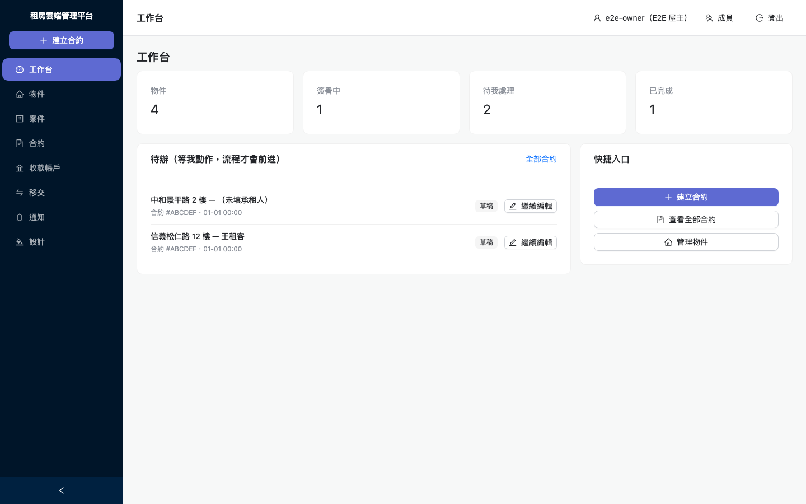

| 項目 | 分數 | 理由 |
| -- | -- | -- |
| 速度 | 4 | 載入中有骨架畫面，約 0.9 秒 |
| 一致 | 2 | 四張數字卡加待辦與快捷入口，只有這頁用這個版型，標題與別頁的頁首不同 |
| 狀態 | 2 | 待辦只列草稿，狀態標籤與合約列表同色，但沒有寫出下一步由誰處理 |
| 導覽 | 4 | 選單標出目前位置（工作台） |
| 視覺 | 1 | 後台殼層側欄是深色，inline style 10 處，寫死色碼 1 處 |
| 回饋 | 1 | 唯讀頁，沒有載入失敗的畫面，也沒有任何回饋呼叫 |

載入量測（第二次載入，dev server）：穩定 931 ms；轉圈取樣 0/3；骨架畫面 有；整頁轉圈 無。

靜態統計：1 個檔案、168 行；inline style 10；寫死色碼 1；寫死 px 2；antd 已棄用 0。

audit：P0 0、P1 0；其他（slop 與 advisory）0；已排除（無障礙與響應式）6。


### 02-contracts-list

合約列表。角色：owner。路由：`/contracts`。版型分類：列表。

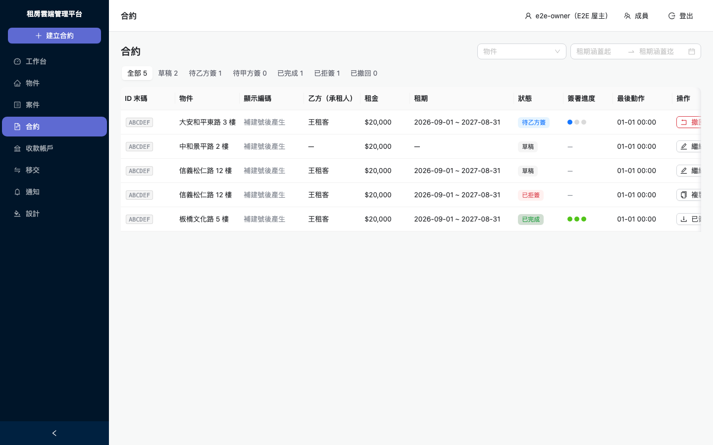

| 項目 | 分數 | 理由 |
| -- | -- | -- |
| 速度 | 3 | 沒有骨架畫面也沒有轉圈，約 1.3 秒才出現內容 |
| 一致 | 2 | 標題、篩選、表格的列表結構，與物件列表、收款帳戶大致相同，篩選列放在標題右側 |
| 狀態 | 3 | 狀態欄用標籤：待乙方簽藍、已拒簽紅、已完成綠，但名稱與案件列表的「簽署中」不同 |
| 導覽 | 4 | 選單標出目前位置（合約） |
| 視覺 | 1 | 後台殼層側欄是深色，inline style 7 處，寫死色碼 3 處，操作欄被截在右邊，要橫向捲動才按得到「撤回」「繼續編輯」 |
| 回饋 | 2 | 撤回與複製有確認與訊息，列表載入失敗沒有處理 |

載入量測（第二次載入，dev server）：穩定 1338 ms；轉圈取樣 0/4；骨架畫面 無；整頁轉圈 無。

靜態統計：1 個檔案、300 行；inline style 7；寫死色碼 3；寫死 px 0；antd 已棄用 0。

audit：P0 0、P1 1；其他（slop 與 advisory）0；已排除（無障礙與響應式）8。

- P1（人工）：1440 寬時表格超出內容區，最右欄的操作按鈕被截掉，主要動作要橫向捲動才找得到

### 03-contract-detail-signing

合約詳情（簽署中）。角色：owner。路由：`/contracts/{signing}`。版型分類：詳情。

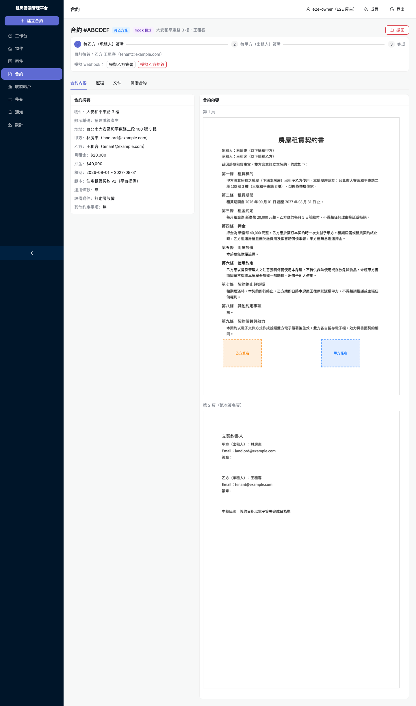

| 項目 | 分數 | 理由 |
| -- | -- | -- |
| 速度 | 2 | 載入中是局部轉圈（15/19 次取樣），約 3.0 秒 |
| 一致 | 2 | 頁首、步驟條、分頁加兩欄內容，是合約專用版型，與案件詳情、物件詳情不同 |
| 狀態 | 3 | 頁首有狀態標籤與三步進度，並寫出「目前待簽：乙方 王租客」，但顏色與列表不共用定義 |
| 導覽 | 2 | 選單標出目前位置（合約），沒有返回列表的連結 |
| 視覺 | 0 | 後台殼層側欄是深色，inline style 34 處，寫死色碼 12 處 |
| 回饋 | 3 | 撤回、取得連結、模擬事件都有訊息與確認，錯誤沒有寫下一步 |

載入量測（第二次載入，dev server）：穩定 3050 ms；轉圈取樣 15/19；骨架畫面 無；整頁轉圈 無。

靜態統計：2 個檔案、1083 行；inline style 34；寫死色碼 12；寫死 px 3；antd 已棄用 6。

audit：P0 0、P1 2；其他（slop 與 advisory）0；已排除（無障礙與響應式）8。

- P1（detect）：first-viewport-column-overflow×1
  - `div.ant-row`：div.ant-row.css-dev-only-do-not-override-ry7cab.css-var-_R_lb_ opens the page with one column running 233% of the viewport tall while a sibl
- P1（人工）：詳情頁沒有返回合約列表的連結，只能靠側欄或瀏覽器上一頁

### 04-contract-detail-completed

合約詳情（已完成）。角色：owner。路由：`/contracts/{completed}`。版型分類：詳情。

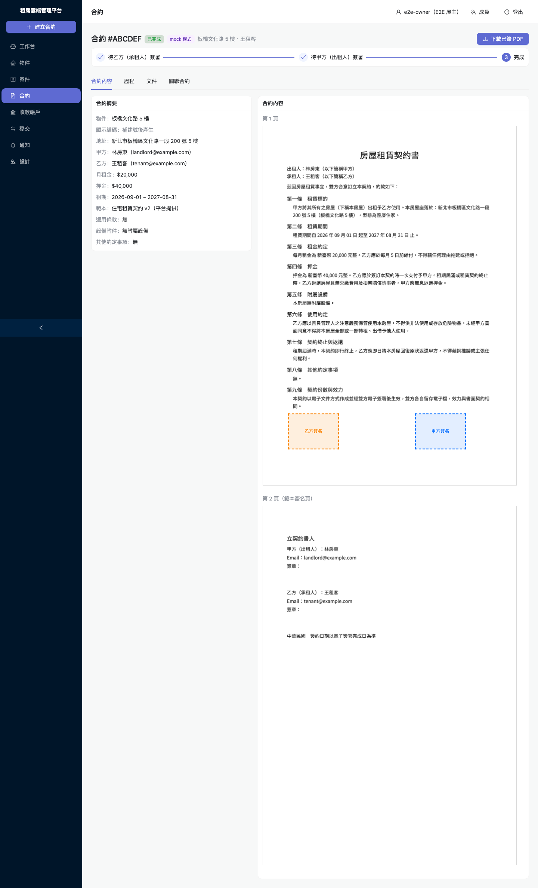

| 項目 | 分數 | 理由 |
| -- | -- | -- |
| 速度 | 2 | 載入中是局部轉圈（25/29 次取樣），約 4.1 秒 |
| 一致 | 2 | 與簽署中的詳情同一版型，主要動作換成下載與複製 |
| 狀態 | 2 | 標籤顯示已完成，頁首沒有寫出後續（案件、帳務）的下一步 |
| 導覽 | 2 | 選單標出目前位置（合約），沒有返回列表的連結 |
| 視覺 | 1 | 後台殼層側欄是深色，inline style 23 處，寫死色碼 1 處 |
| 回饋 | 3 | 下載與複製有訊息，錯誤沒有寫下一步 |

載入量測（第二次載入，dev server）：穩定 4146 ms；轉圈取樣 25/29；骨架畫面 無；整頁轉圈 無。

靜態統計：1 個檔案、737 行；inline style 23；寫死色碼 1；寫死 px 0；antd 已棄用 4。

audit：P0 0、P1 2；其他（slop 與 advisory）0；已排除（無障礙與響應式）6。

- P1（detect）：first-viewport-column-overflow×1
  - `div.ant-row`：div.ant-row.css-dev-only-do-not-override-ry7cab.css-var-_R_lb_ opens the page with one column running 233% of the viewport tall while a sibl
- P1（人工）：詳情頁沒有返回合約列表的連結

### 05-contract-detail-draft

合約詳情（草稿）。角色：owner。路由：`/contracts/{readyDraft}`。版型分類：詳情。

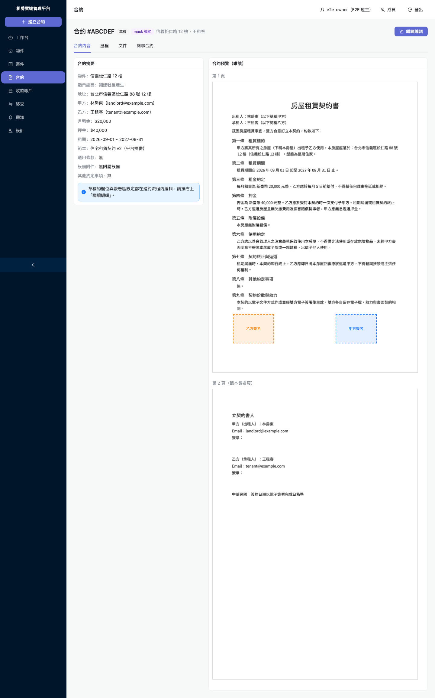

| 項目 | 分數 | 理由 |
| -- | -- | -- |
| 速度 | 2 | 載入中是局部轉圈（14/18 次取樣），約 2.8 秒 |
| 一致 | 2 | 與簽署中的詳情同一版型，草稿多一個提示卡 |
| 狀態 | 3 | 草稿標籤加提示「請按右上繼續編輯」，下一步寫在內容區，不在頁首 |
| 導覽 | 2 | 選單標出目前位置（合約），沒有返回列表的連結 |
| 視覺 | 1 | 後台殼層側欄是深色，inline style 23 處，寫死色碼 1 處 |
| 回饋 | 3 | 複製與刪除有確認與訊息，錯誤沒有寫下一步 |

載入量測（第二次載入，dev server）：穩定 2804 ms；轉圈取樣 14/18；骨架畫面 無；整頁轉圈 無。

靜態統計：1 個檔案、737 行；inline style 23；寫死色碼 1；寫死 px 0；antd 已棄用 4。

audit：P0 0、P1 2；其他（slop 與 advisory）1；已排除（無障礙與響應式）5。

- P1（detect）：first-viewport-column-overflow×1
  - `div.ant-row`：div.ant-row.css-dev-only-do-not-override-ry7cab.css-var-_R_lb_ opens the page with one column running 233% of the viewport tall while a sibl
- P1（人工）：詳情頁沒有返回合約列表的連結
- 其他：nested-cards×1
  - `div.ant-alert.ant-alert-info`：Card inside card

### 06-contract-detail-declined

合約詳情（已拒簽）。角色：owner。路由：`/contracts/{declined}`。版型分類：詳情。

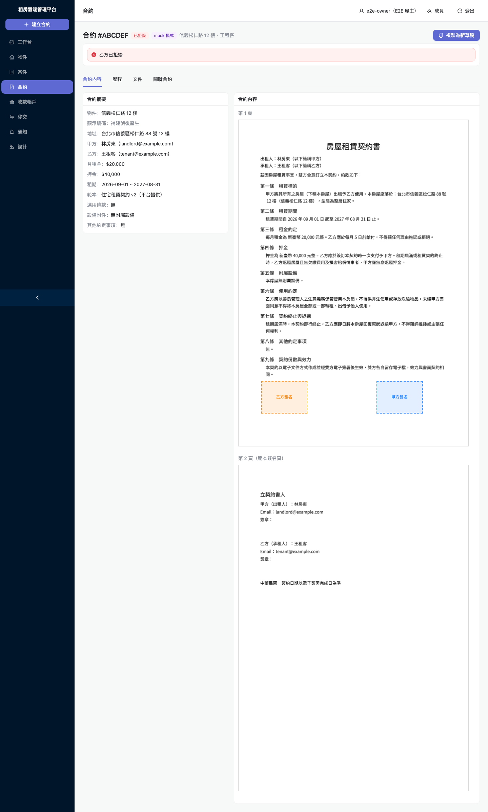

| 項目 | 分數 | 理由 |
| -- | -- | -- |
| 速度 | 2 | 載入中是局部轉圈（10/14 次取樣），約 2.6 秒 |
| 一致 | 2 | 與簽署中的詳情同一版型 |
| 狀態 | 2 | 標籤顯示已拒簽（紅），但沒有寫出誰拒簽、下一步怎麼重新送簽 |
| 導覽 | 2 | 選單標出目前位置（合約），沒有返回列表的連結 |
| 視覺 | 1 | 後台殼層側欄是深色，inline style 23 處，寫死色碼 1 處 |
| 回饋 | 3 | 複製有訊息，錯誤沒有寫下一步 |

載入量測（第二次載入，dev server）：穩定 2559 ms；轉圈取樣 10/14；骨架畫面 無；整頁轉圈 無。

靜態統計：1 個檔案、737 行；inline style 23；寫死色碼 1；寫死 px 0；antd 已棄用 4。

audit：P0 0、P1 2；其他（slop 與 advisory）0；已排除（無障礙與響應式）6。

- P1（detect）：first-viewport-column-overflow×1
  - `div.ant-row`：div.ant-row.css-dev-only-do-not-override-ry7cab.css-var-_R_lb_ opens the page with one column running 233% of the viewport tall while a sibl
- P1（人工）：詳情頁沒有返回合約列表的連結；拒簽後的處理動作不明確（MIL-167 使用者故事 26）

### 07-wizard-1-property

建約精靈 步驟一 選物件。角色：owner。路由：`/contracts/new`。版型分類：精靈。

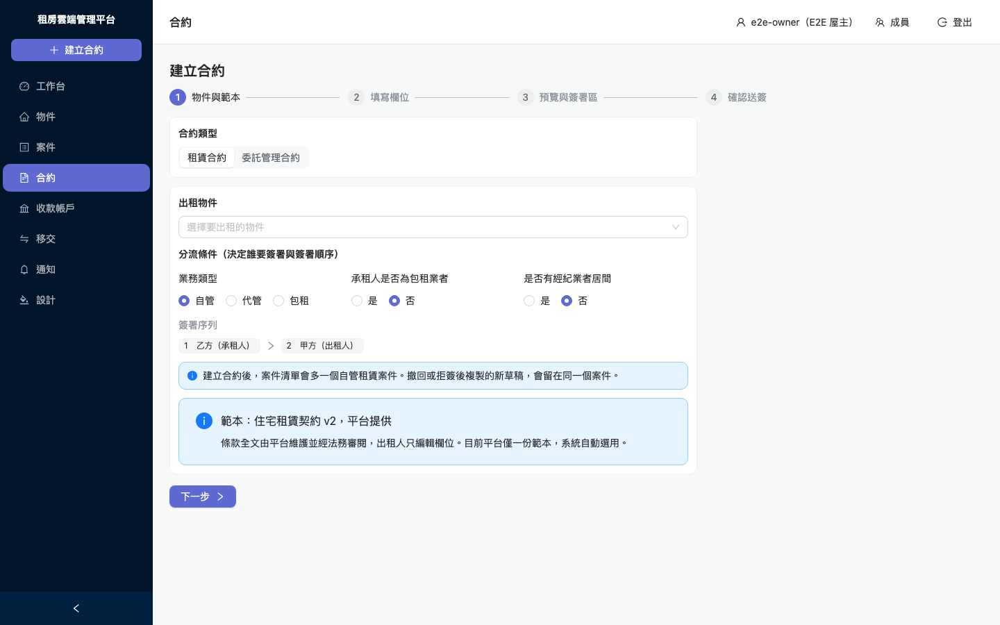

| 項目 | 分數 | 理由 |
| -- | -- | -- |
| 速度 | 3 | 沒有骨架畫面也沒有轉圈，約 1.2 秒才出現內容 |
| 一致 | 2 | 步驟條在標題下方，內容卡片只佔左側約 2/3，右側留空；與合約詳情的兩欄不同 |
| 狀態 | 2 | 簽署序列以標籤列出，沒有狀態概念；提示用兩種不同樣式的藍色提示框 |
| 導覽 | 4 | 選單標出目前位置（合約） |
| 視覺 | 0 | 後台殼層側欄是深色，inline style 63 處，寫死色碼 2 處 |
| 回饋 | 3 | 欄位錯誤與提示都有，送出前檢查會列出原因 |

載入量測（第二次載入，dev server）：穩定 1238 ms；轉圈取樣 0/4；骨架畫面 無；整頁轉圈 無。

靜態統計：9 個檔案、2076 行；inline style 63；寫死色碼 2；寫死 px 4；antd 已棄用 9。

audit：P0 0、P1 0；其他（slop 與 advisory）2；已排除（無障礙與響應式）5。

- 其他：nested-cards×1、bounce-easing×1
  - `div.ant-space-item:nth-of-type(4) > div.ant-alert.ant-alert-info`：Card inside card
  - `body`：cubic-bezier(0.12, 0.4, 0.29, 1.46)

### 08-wizard-2-fields

建約精靈 步驟二 填欄位。角色：owner。路由：`/contracts/{bareDraft}/edit`。版型分類：精靈。

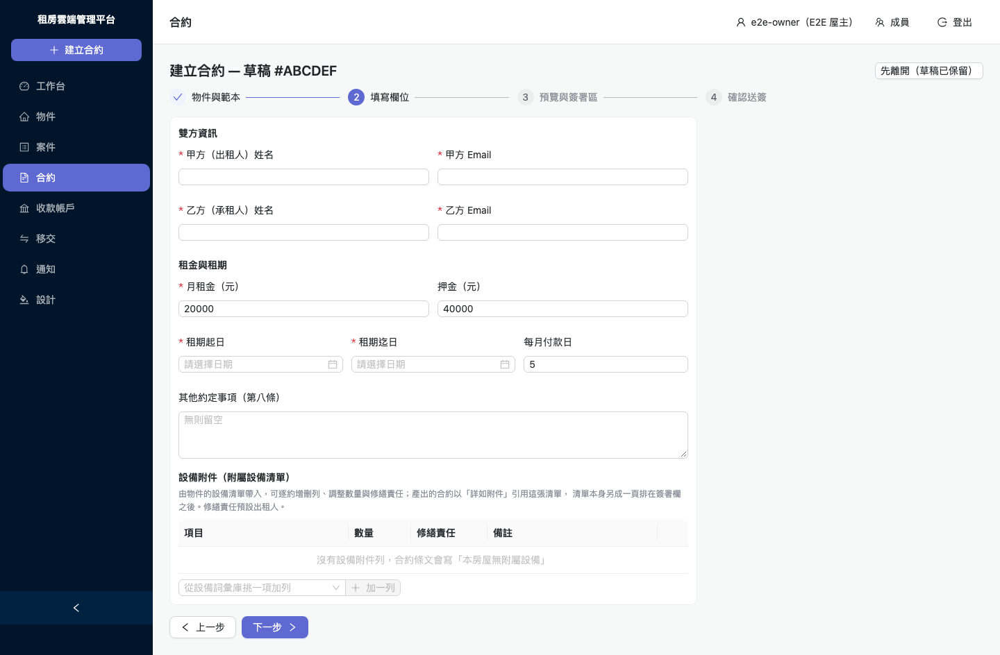

| 項目 | 分數 | 理由 |
| -- | -- | -- |
| 速度 | 3 | 沒有骨架畫面也沒有轉圈，約 1.7 秒才出現內容 |
| 一致 | 2 | 與其他精靈步驟同一結構，按鈕在表單下方，位置隨表單高度移動 |
| 狀態 | 2 | 步驟條標出目前與已完成步驟，欄位必填以紅星標示 |
| 導覽 | 4 | 選單標出目前位置（合約） |
| 視覺 | 0 | 後台殼層側欄是深色，inline style 53 處，寫死色碼 2 處 |
| 回饋 | 3 | 欄位錯誤顯示在欄位旁，草稿自動保存有提示 |

載入量測（第二次載入，dev server）：穩定 1710 ms；轉圈取樣 0/4；骨架畫面 無；整頁轉圈 無。

靜態統計：9 個檔案、1911 行；inline style 53；寫死色碼 2；寫死 px 3；antd 已棄用 7。

audit：P0 0、P1 0；其他（slop 與 advisory）1；已排除（無障礙與響應式）8。

- 其他：bounce-easing×1
  - `body`：cubic-bezier(0.12, 0.4, 0.29, 1.46)

### 09-wizard-3-signature

建約精靈 步驟三 簽署區。角色：owner。路由：`/contracts/{readyDraft}/edit`。版型分類：精靈。

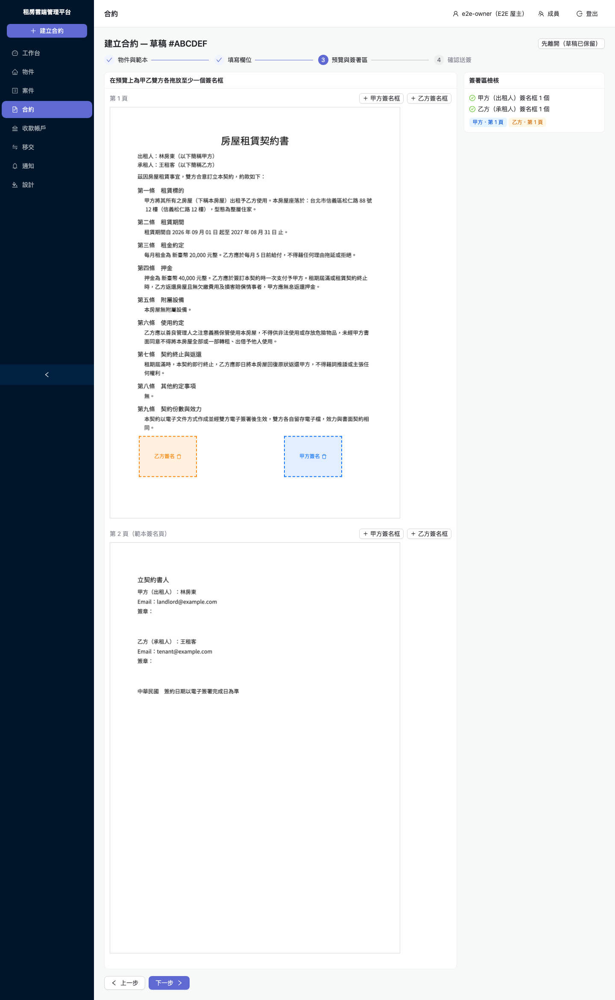

| 項目 | 分數 | 理由 |
| -- | -- | -- |
| 速度 | 2 | 載入中是局部轉圈（1/4 次取樣），約 1.3 秒 |
| 一致 | 2 | 與其他精靈步驟同一結構，預覽與簽署區檢核分兩欄 |
| 狀態 | 3 | 右欄的簽署區檢核用綠色勾與標籤顯示甲乙方是否放好 |
| 導覽 | 4 | 選單標出目前位置（合約） |
| 視覺 | 0 | 後台殼層側欄是深色，inline style 64 處，寫死色碼 13 處 |
| 回饋 | 3 | 放置、刪除簽名框有檢核即時更新，缺少時有提示 |

載入量測（第二次載入，dev server）：穩定 1346 ms；轉圈取樣 1/4；骨架畫面 無；整頁轉圈 無。

靜態統計：10 個檔案、2257 行；inline style 64；寫死色碼 13；寫死 px 6；antd 已棄用 9。

audit：P0 0、P1 1；其他（slop 與 advisory）0；已排除（無障礙與響應式）5。

- P1（detect）：first-viewport-column-overflow×1
  - `div.ant-row`：div.ant-row.css-dev-only-do-not-override-ry7cab.css-var-_R_lb_ opens the page with one column running 233% of the viewport tall while a sibl

### 10-wizard-4-confirm

建約精靈 步驟四 確認送簽。角色：owner。路由：`/contracts/{readyDraft}/edit`。版型分類：精靈。

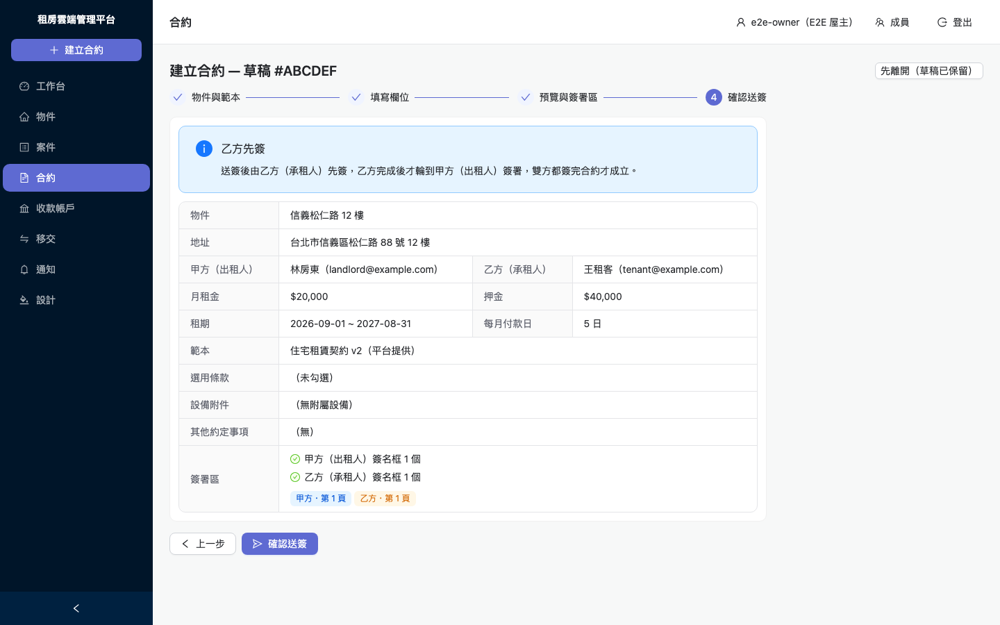

| 項目 | 分數 | 理由 |
| -- | -- | -- |
| 速度 | 2 | 載入中是局部轉圈（1/4 次取樣），約 1.3 秒 |
| 一致 | 2 | 與其他精靈步驟同一結構，確認頁用表格摘要，與合約詳情的摘要卡片不同 |
| 狀態 | 3 | 最上方寫出「乙方先簽」的簽署順序，確認後送出 |
| 導覽 | 4 | 選單標出目前位置（合約） |
| 視覺 | 0 | 後台殼層側欄是深色，inline style 53 處，寫死色碼 2 處 |
| 回饋 | 3 | 送簽失敗會列出全部原因，成功後導向詳情頁 |

載入量測（第二次載入，dev server）：穩定 1330 ms；轉圈取樣 1/4；骨架畫面 無；整頁轉圈 無。

靜態統計：9 個檔案、1911 行；inline style 53；寫死色碼 2；寫死 px 3；antd 已棄用 7。

audit：P0 0、P1 0；其他（slop 與 advisory）2；已排除（無障礙與響應式）1。

- 其他：nested-cards×2
  - `div.ant-alert.ant-alert-info`：Card inside card
  - `div.ant-descriptions-view`：Card inside card

### 11-properties-list

物件列表。角色：owner。路由：`/properties`。版型分類：列表。

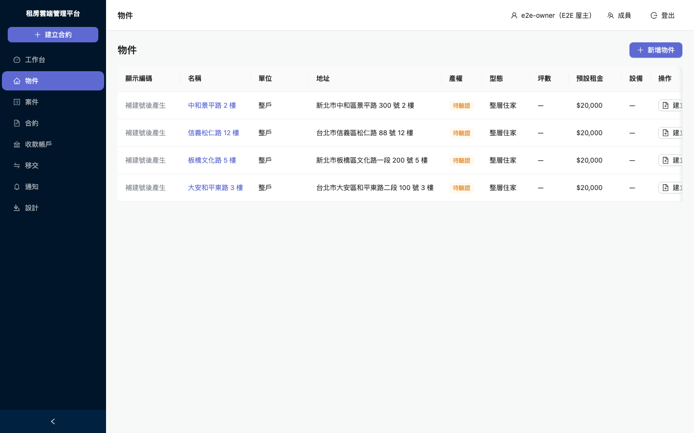

| 項目 | 分數 | 理由 |
| -- | -- | -- |
| 速度 | 2 | 載入中是局部轉圈（1/4 次取樣），約 1.3 秒 |
| 一致 | 2 | 標題加右側主要按鈕加表格，與合約列表近似，但沒有篩選列 |
| 狀態 | 2 | 產權欄用橘色「待驗證」標籤，名稱與其他頁的待驗證不同色 |
| 導覽 | 4 | 選單標出目前位置（物件） |
| 視覺 | 0 | 後台殼層側欄是深色，inline style 12 處，操作欄被截在右邊，要橫向捲動才按得到 |
| 回饋 | 3 | 新增、編輯、封存有訊息與確認 |

載入量測（第二次載入，dev server）：穩定 1327 ms；轉圈取樣 1/4；骨架畫面 無；整頁轉圈 無。

靜態統計：2 個檔案、594 行；inline style 12；寫死色碼 0；寫死 px 2；antd 已棄用 3。

audit：P0 1、P1 1；其他（slop 與 advisory）1；已排除（無障礙與響應式）5。

- P0（detect）：script-error×1
  - ``：Uncaught Error: Hydration failed because the server rendered HTML didn't match the client. As a result this tree will be regenerated on the 
- P1（人工）：1440 寬時表格超出內容區，最右欄的操作按鈕被截掉
- 其他：bounce-easing×1
  - `body`：cubic-bezier(0.12, 0.4, 0.29, 1.46)

### 12-property-detail

物件詳情。角色：owner。路由：`/properties/{property}`。版型分類：詳情。

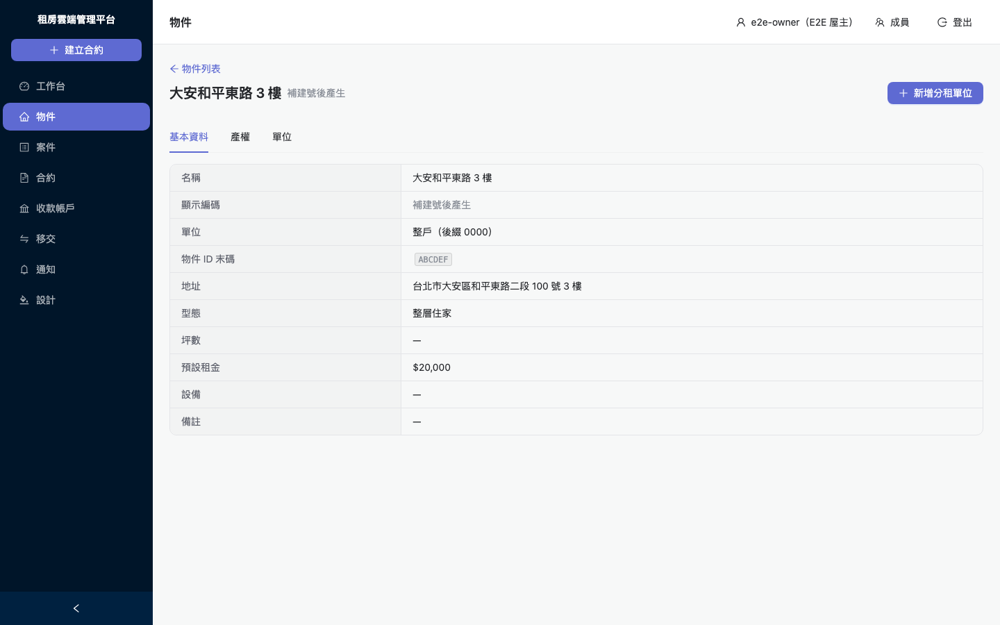

| 項目 | 分數 | 理由 |
| -- | -- | -- |
| 速度 | 3 | 沒有骨架畫面也沒有轉圈，約 1.4 秒才出現內容 |
| 一致 | 2 | 返回連結、標題、分頁、描述表，與案件詳情近似，與合約詳情不同 |
| 狀態 | 2 | 沒有狀態標籤，產權狀態在別的分頁 |
| 導覽 | 4 | 選單標出目前位置（物件），有返回列表的連結 |
| 視覺 | 2 | 後台殼層側欄是深色，inline style 7 處 |
| 回饋 | 3 | 儲存與新增分租單位有訊息 |

載入量測（第二次載入，dev server）：穩定 1359 ms；轉圈取樣 0/4；骨架畫面 無；整頁轉圈 無。

靜態統計：2 個檔案、576 行；inline style 7；寫死色碼 0；寫死 px 0；antd 已棄用 3。

audit：P0 0、P1 0；其他（slop 與 advisory）0；已排除（無障礙與響應式）4。


### 13-cases-list

案件列表。角色：owner。路由：`/cases`。版型分類：列表。

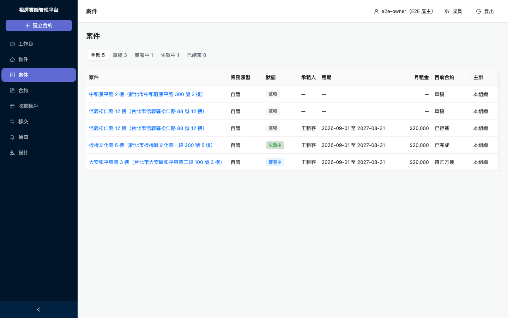

| 項目 | 分數 | 理由 |
| -- | -- | -- |
| 速度 | 2 | 載入中是局部轉圈（1/4 次取樣），約 2.9 秒 |
| 一致 | 2 | 分頁籤加表格，與合約列表同一族，但沒有標題列的主要按鈕 |
| 狀態 | 2 | 案件狀態用標籤，「目前合約」欄卻是純文字，同一個合約狀態在這裡沒有顏色 |
| 導覽 | 4 | 選單標出目前位置（案件） |
| 視覺 | 2 | 後台殼層側欄是深色，inline style 1 處 |
| 回饋 | 1 | 唯讀列表，沒有載入失敗的畫面 |

載入量測（第二次載入，dev server）：穩定 2941 ms；轉圈取樣 1/4；骨架畫面 無；整頁轉圈 無。

靜態統計：1 個檔案、118 行；inline style 1；寫死色碼 0；寫死 px 0；antd 已棄用 0。

audit：P0 0、P1 1；其他（slop 與 advisory）0；已排除（無障礙與響應式）3。

- P1（人工）：「目前合約」欄的合約狀態是純文字，與合約列表的有色標籤不同（MIL-167 使用者故事 2）

### 14-case-detail-overview

案件詳情（概況）。角色：owner。路由：`/cases/{case}`。版型分類：詳情。

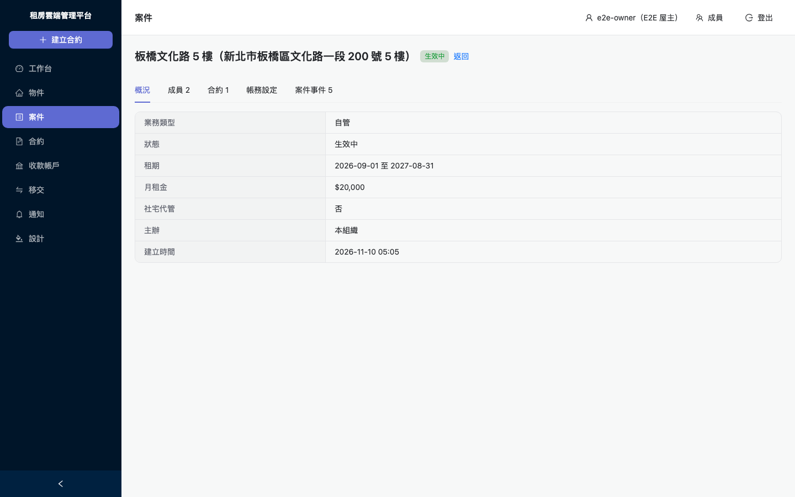

| 項目 | 分數 | 理由 |
| -- | -- | -- |
| 速度 | 3 | 沒有骨架畫面也沒有轉圈，約 1.5 秒才出現內容 |
| 一致 | 2 | 標題旁有狀態與返回連結、分頁，與物件詳情近似 |
| 狀態 | 3 | 頁首有案件狀態標籤，概況表寫出狀態與主辦 |
| 導覽 | 4 | 選單標出目前位置（案件），有返回列表的連結 |
| 視覺 | 2 | 後台殼層側欄是深色，inline style 2 處 |
| 回饋 | 2 | 唯讀概況，成員與合約分頁有操作訊息 |

載入量測（第二次載入，dev server）：穩定 1523 ms；轉圈取樣 0/4；骨架畫面 無；整頁轉圈 無。

靜態統計：2 個檔案、313 行；inline style 2；寫死色碼 0；寫死 px 0；antd 已棄用 1。

audit：P0 0、P1 0；其他（slop 與 advisory）0；已排除（無障礙與響應式）3。


### 15-case-detail-ledger

案件詳情（帳務設定）。角色：owner。路由：`/cases/{case}#ledger`。版型分類：詳情。

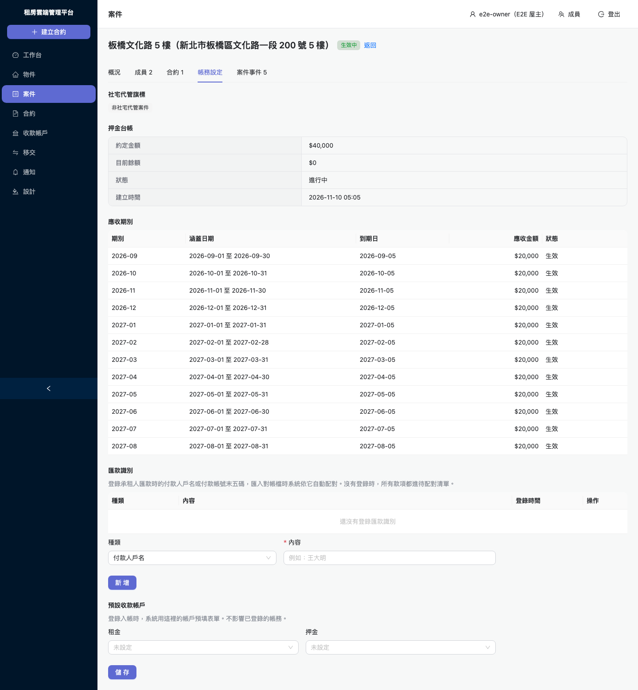

| 項目 | 分數 | 理由 |
| -- | -- | -- |
| 速度 | 3 | 沒有骨架畫面也沒有轉圈，約 1.3 秒才出現內容 |
| 一致 | 2 | 分頁內縱向堆疊五個區塊，標題層級與其他詳情頁的描述表不同 |
| 狀態 | 3 | 押金台帳顯示狀態與餘額，應收期別顯示「生效」，詞彙與合約狀態不同 |
| 導覽 | 4 | 選單標出目前位置（案件），有返回列表的連結 |
| 視覺 | 2 | 後台殼層側欄是深色，inline style 2 處 |
| 回饋 | 3 | 登錄與儲存有成功訊息（驗收時確認），錯誤沒有寫下一步 |

載入量測（第二次載入，dev server）：穩定 1322 ms；轉圈取樣 0/4；骨架畫面 無；整頁轉圈 無。

靜態統計：3 個檔案、776 行；inline style 2；寫死色碼 0；寫死 px 0；antd 已棄用 3。

audit：P0 0、P1 0；其他（slop 與 advisory）1；已排除（無障礙與響應式）8。

- 其他：bounce-easing×1
  - `body`：cubic-bezier(0.12, 0.4, 0.29, 1.46)

### 16-payment-accounts

收款帳戶。角色：owner。路由：`/payment-accounts`。版型分類：列表。

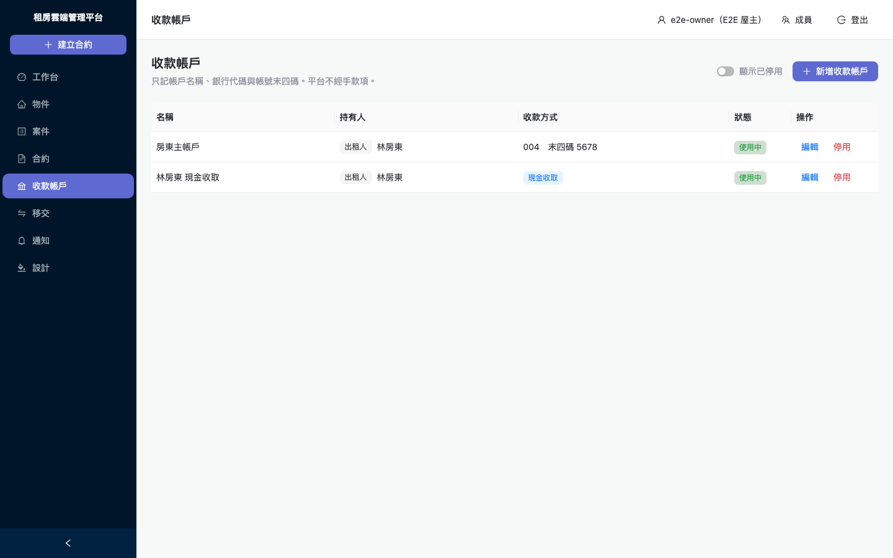

| 項目 | 分數 | 理由 |
| -- | -- | -- |
| 速度 | 2 | 載入中是局部轉圈（1/4 次取樣），約 1.3 秒 |
| 一致 | 2 | 標題加說明加右側按鈕加表格，與合約列表近似 |
| 狀態 | 3 | 使用中綠色標籤、現金收取藍色標籤，持有人角色用灰色標籤 |
| 導覽 | 4 | 選單標出目前位置（收款帳戶） |
| 視覺 | 2 | 後台殼層側欄是深色，inline style 4 處 |
| 回饋 | 3 | 新增、編輯、停用有確認與訊息 |

載入量測（第二次載入，dev server）：穩定 1306 ms；轉圈取樣 1/4；骨架畫面 無；整頁轉圈 無。

靜態統計：1 個檔案、340 行；inline style 4；寫死色碼 0；寫死 px 0；antd 已棄用 0。

audit：P0 0、P1 0；其他（slop 與 advisory）0；已排除（無障礙與響應式）5。


### 17-notifications

站內通知。角色：owner。路由：`/notifications`。版型分類：列表。

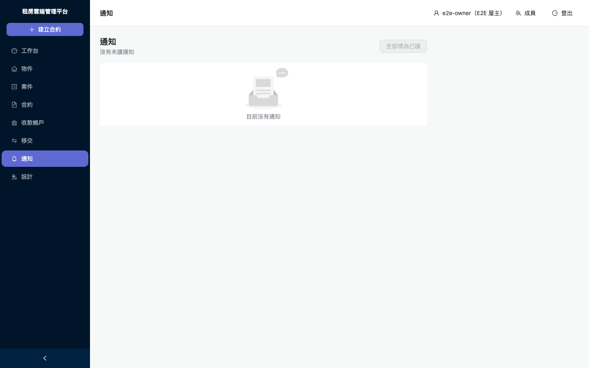

| 項目 | 分數 | 理由 |
| -- | -- | -- |
| 速度 | 3 | 沒有骨架畫面也沒有轉圈，約 1.5 秒才出現內容 |
| 一致 | 1 | 內容只佔左側 800px，與其他列表滿版不同，用卡片加清單而不是表格 |
| 狀態 | 1 | 沒有通知時只顯示空狀態，未讀以圓點與粗體標示，沒有狀態標籤 |
| 導覽 | 4 | 選單標出目前位置（通知） |
| 視覺 | 2 | 後台殼層側欄是深色，inline style 3 處 |
| 回饋 | 2 | 標已讀有訊息，載入失敗顯示整頁錯誤 |

載入量測（第二次載入，dev server）：穩定 1484 ms；轉圈取樣 0/4；骨架畫面 無；整頁轉圈 無。

靜態統計：1 個檔案、132 行；inline style 3；寫死色碼 0；寫死 px 0；antd 已棄用 0。

audit：P0 0、P1 0；其他（slop 與 advisory）0；已排除（無障礙與響應式）2。


### 18-members

成員設定。角色：owner。路由：`/settings/members`。版型分類：面板。

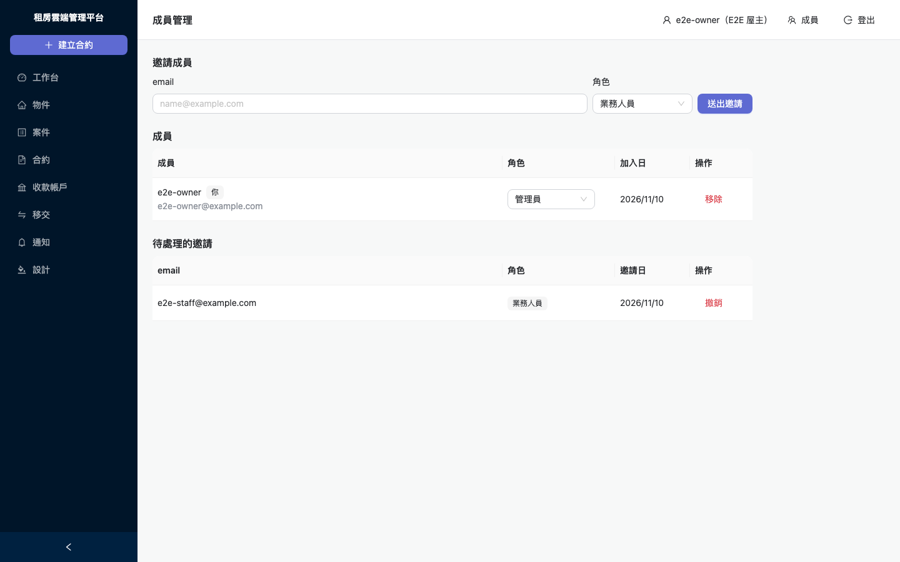

| 項目 | 分數 | 理由 |
| -- | -- | -- |
| 速度 | 2 | 沒有骨架畫面也沒有轉圈，約 2.6 秒才出現內容 |
| 一致 | 1 | 三段縱向表單與表格，沒有頁首區，標題在頂部列 |
| 狀態 | 2 | 角色用標籤，邀請狀態沒有標籤 |
| 導覽 | 2 | 選單沒有標出目前位置 |
| 視覺 | 2 | 後台殼層側欄是深色，inline style 8 處 |
| 回饋 | 3 | 邀請、改角色、移除有訊息與確認 |

載入量測（第二次載入，dev server）：穩定 2577 ms；轉圈取樣 0/3；骨架畫面 無；整頁轉圈 無。

靜態統計：2 個檔案、294 行；inline style 8；寫死色碼 0；寫死 px 2；antd 已棄用 0。

audit：P0 0、P1 0；其他（slop 與 advisory）1；已排除（無障礙與響應式）2。

- 其他：bounce-easing×1
  - `body`：cubic-bezier(0.12, 0.4, 0.29, 1.46)

### 19-owner-overview

屋主資產總覽。角色：owner。路由：`/owner`。版型分類：總覽。

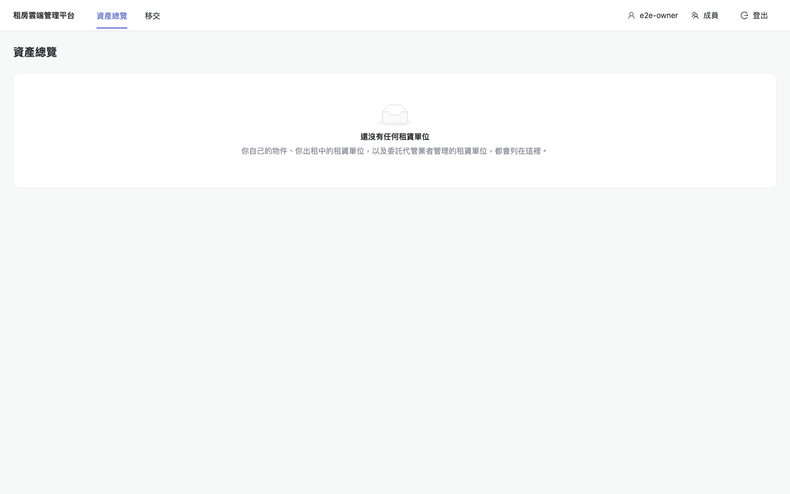

| 項目 | 分數 | 理由 |
| -- | -- | -- |
| 速度 | 3 | 沒有骨架畫面也沒有轉圈，約 1.3 秒才出現內容 |
| 一致 | 2 | 屋主端頂部選單殼層，內容為卡片，與後台殼層不同 |
| 狀態 | 1 | 空狀態（資料來自假資料 adapter，真實帳號沒有資料），沒有狀態呈現可評 |
| 導覽 | 4 | 選單標出目前位置（資產總覽） |
| 視覺 | 3 | 殼層是亮色，inline style 4 處 |
| 回饋 | 1 | 唯讀頁，只有空狀態說明 |

載入量測（第二次載入，dev server）：穩定 1287 ms；轉圈取樣 0/3；骨架畫面 無；整頁轉圈 無。

靜態統計：3 個檔案、604 行；inline style 4；寫死色碼 0；寫死 px 15；antd 已棄用 0。

audit：P0 0、P1 0；其他（slop 與 advisory）0；已排除（無障礙與響應式）1。


### 20-owner-handovers

屋主端 移交清單。角色：owner。路由：`/owner/handovers`。版型分類：列表。

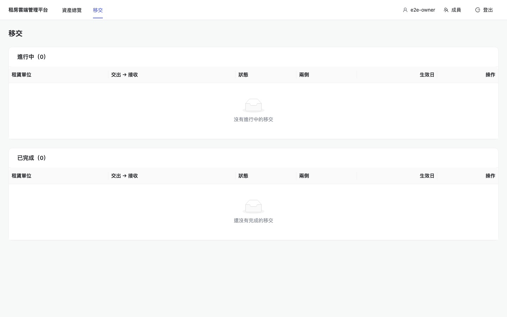

| 項目 | 分數 | 理由 |
| -- | -- | -- |
| 速度 | 3 | 沒有骨架畫面也沒有轉圈，約 1.4 秒才出現內容 |
| 一致 | 2 | 兩張卡片各含一張表，與後台的移交清單結構不同 |
| 狀態 | 1 | 兩個區塊都是空狀態（資料來自假資料 adapter），無法評狀態呈現 |
| 導覽 | 4 | 選單標出目前位置（移交） |
| 視覺 | 3 | 殼層是亮色，inline style 9 處 |
| 回饋 | 2 | 空狀態有說明，沒有其他操作 |

載入量測（第二次載入，dev server）：穩定 1387 ms；轉圈取樣 0/4；骨架畫面 無；整頁轉圈 無。

靜態統計：4 個檔案、332 行；inline style 9；寫死色碼 0；寫死 px 8；antd 已棄用 0。

audit：P0 0、P1 0；其他（slop 與 advisory）0；已排除（無障礙與響應式）2。


### 21-owner-handover-new

屋主端 發起移交。角色：owner。路由：`/owner/handovers/new`。版型分類：表單。

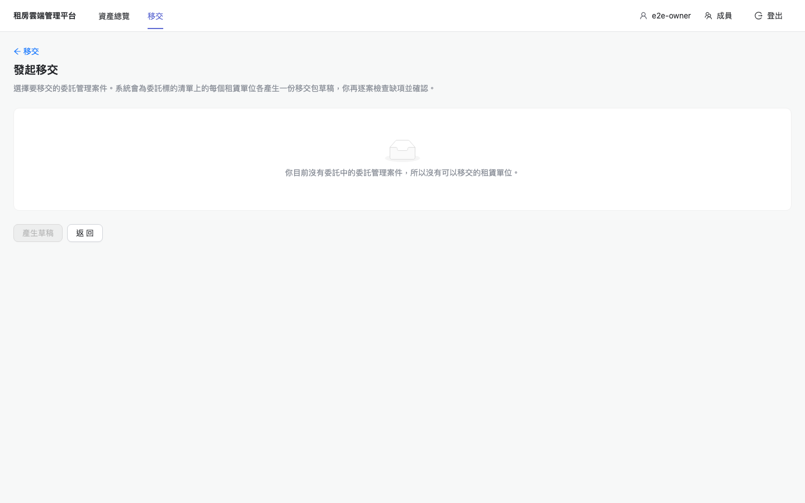

| 項目 | 分數 | 理由 |
| -- | -- | -- |
| 速度 | 3 | 沒有骨架畫面也沒有轉圈，約 1.6 秒才出現內容 |
| 一致 | 2 | 返回連結、標題、說明、卡片、按鈕，結構接近發起類表單 |
| 狀態 | 1 | 空狀態，無委託中的案件，「產生草稿」按鈕停用 |
| 導覽 | 4 | 選單標出目前位置（移交） |
| 視覺 | 3 | 殼層是亮色，inline style 6 處 |
| 回饋 | 2 | 空狀態說明原因，停用按鈕沒有說明如何啟用 |

載入量測（第二次載入，dev server）：穩定 1582 ms；轉圈取樣 0/4；骨架畫面 無；整頁轉圈 無。

靜態統計：2 個檔案、127 行；inline style 6；寫死色碼 0；寫死 px 0；antd 已棄用 0。

audit：P0 0、P1 0；其他（slop 與 advisory）0；已排除（無障礙與響應式）3。


### 22-owner-handover-detail

屋主端 移交詳情。角色：owner。路由：`/owner/handovers/{handover}`。版型分類：詳情。

沒有截圖。沒有畫面。移交資料在假資料 adapter，真實登入的帳號讀不到任何移交，這頁無法從畫面進入。評分用原始碼推估，不列入平均。

沒有畫面。移交資料在假資料 adapter，真實登入的帳號讀不到任何移交，這頁無法從畫面進入。評分用原始碼推估，不列入平均。

靜態統計：4 個檔案、513 行；inline style 16；寫死色碼 0；寫死 px 0；antd 已棄用 0。

audit：P0 0、P1 0；其他（slop 與 advisory）0；已排除（無障礙與響應式）0。


### 23-owner-case-detail

屋主端 案件詳情。角色：owner。路由：`/owner/cases/{case}`。版型分類：詳情。

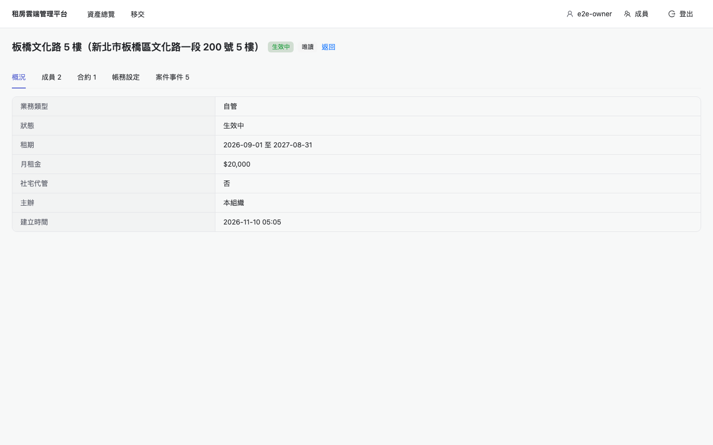

| 項目 | 分數 | 理由 |
| -- | -- | -- |
| 速度 | 2 | 載入中是局部轉圈（1/5 次取樣），約 1.5 秒 |
| 一致 | 2 | 與後台的案件詳情同一元件，殼層換成屋主端頂部選單 |
| 狀態 | 3 | 頁首有案件狀態與「唯讀」標籤 |
| 導覽 | 2 | 選單沒有標出目前位置，有返回列表的連結 |
| 視覺 | 3 | 殼層是亮色，inline style 2 處 |
| 回饋 | 2 | 唯讀版本，沒有編輯操作 |

載入量測（第二次載入，dev server）：穩定 1500 ms；轉圈取樣 1/5；骨架畫面 無；整頁轉圈 無。

靜態統計：2 個檔案、316 行；inline style 2；寫死色碼 0；寫死 px 0；antd 已棄用 1。

audit：P0 0、P1 0；其他（slop 與 advisory）0；已排除（無障礙與響應式）3。


### 24-org-handovers

後台 移交清單。角色：practice。路由：`/handovers`。版型分類：列表。

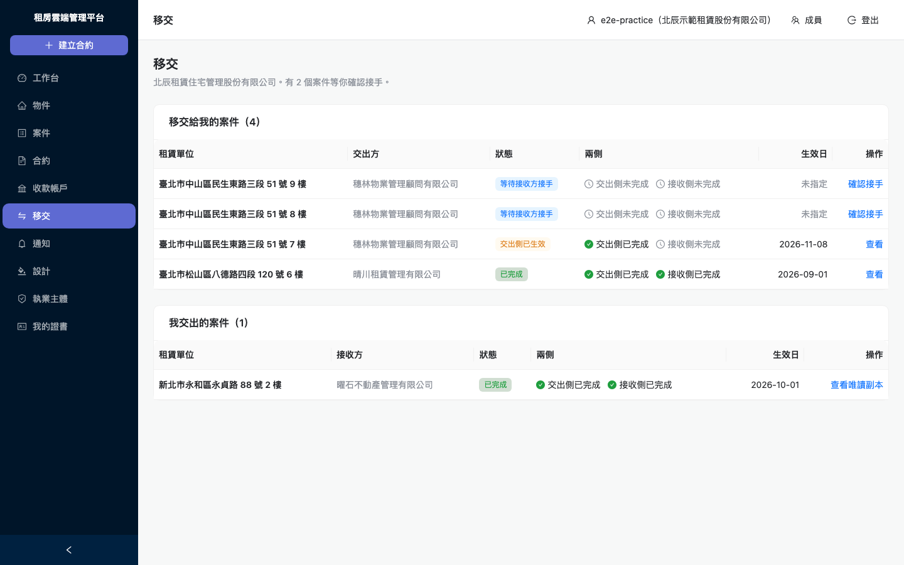

| 項目 | 分數 | 理由 |
| -- | -- | -- |
| 速度 | 3 | 沒有骨架畫面也沒有轉圈，約 1.4 秒才出現內容 |
| 一致 | 2 | 摘要句加兩張卡片各含一張表，與屋主端的移交清單同一做法 |
| 狀態 | 3 | 狀態標籤有等待（藍）、交出側已生效（橘）、已完成（綠），兩側完成度用圖示，但名稱與合約狀態不共用 |
| 導覽 | 4 | 選單標出目前位置（移交） |
| 視覺 | 2 | 後台殼層側欄是深色，inline style 2 處 |
| 回饋 | 1 | 唯讀清單，沒有載入失敗的畫面 |

載入量測（第二次載入，dev server）：穩定 1375 ms；轉圈取樣 0/4；骨架畫面 無；整頁轉圈 無。

靜態統計：3 個檔案、162 行；inline style 2；寫死色碼 0；寫死 px 0；antd 已棄用 0。

audit：P0 0、P1 0；其他（slop 與 advisory）0；已排除（無障礙與響應式）8。


### 25-org-handover-detail

後台 移交詳情。角色：practice。路由：`/handovers/{orgHandover}`。版型分類：詳情。

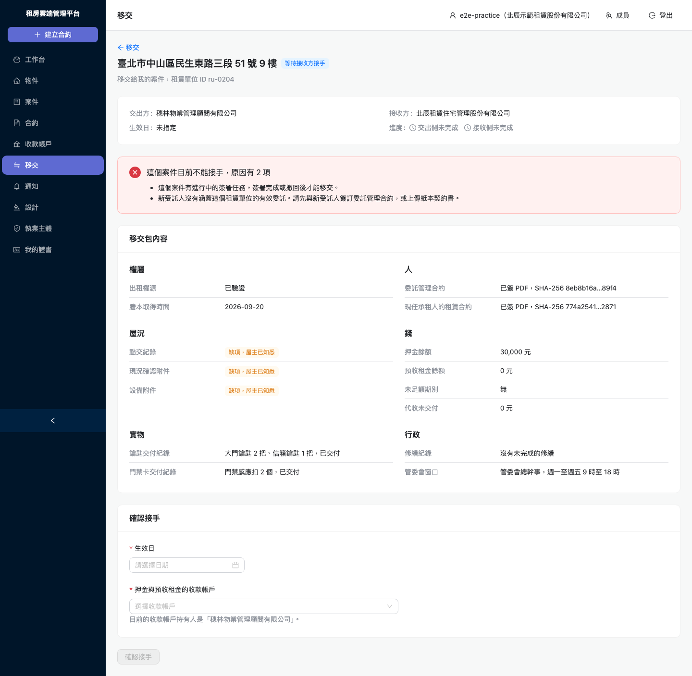

| 項目 | 分數 | 理由 |
| -- | -- | -- |
| 速度 | 3 | 沒有骨架畫面也沒有轉圈，約 1.4 秒才出現內容 |
| 一致 | 2 | 移交詳情用卡片與提示，與合約詳情不同 |
| 狀態 | 2 | 有狀態標籤與接手條件提示，沒有寫出下一步由誰處理 |
| 導覽 | 2 | 選單標出目前位置（移交），沒有返回列表的連結 |
| 視覺 | 2 | 後台殼層側欄是深色，inline style 7 處 |
| 回饋 | 3 | 接手、確認有訊息 |

載入量測（第二次載入，dev server）：穩定 1388 ms；轉圈取樣 0/4；骨架畫面 無；整頁轉圈 無。

靜態統計：3 個檔案、388 行；inline style 7；寫死色碼 0；寫死 px 0；antd 已棄用 0。

audit：P0 0、P1 0；其他（slop 與 advisory）1；已排除（無障礙與響應式）10。

- 其他：bounce-easing×1
  - `body`：cubic-bezier(0.12, 0.4, 0.29, 1.46)

### 26-practice

執業主體。角色：practice。路由：`/practice`。版型分類：面板。

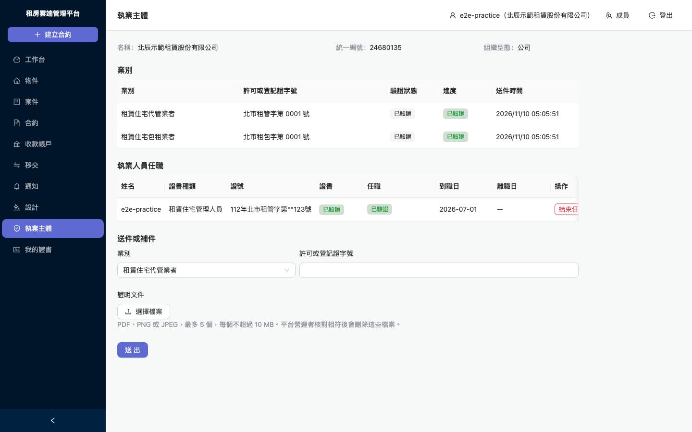

| 項目 | 分數 | 理由 |
| -- | -- | -- |
| 速度 | 3 | 沒有骨架畫面也沒有轉圈，約 1.8 秒才出現內容 |
| 一致 | 1 | 縱向堆疊的資料區塊，沒有頁首與主要按鈕區 |
| 狀態 | 2 | 「驗證狀態」與「進度」兩欄都顯示已驗證，一個灰色、一個綠色，同一狀態兩種顏色 |
| 導覽 | 4 | 選單標出目前位置（執業主體） |
| 視覺 | 1 | 後台殼層側欄是深色，inline style 5 處，任職表的操作欄被截在右邊 |
| 回饋 | 2 | 送件有訊息，錯誤沒有寫下一步 |

載入量測（第二次載入，dev server）：穩定 1838 ms；轉圈取樣 0/4；骨架畫面 無；整頁轉圈 無。

靜態統計：2 個檔案、227 行；inline style 5；寫死色碼 0；寫死 px 2；antd 已棄用 0。

audit：P0 0、P1 1；其他（slop 與 advisory）1；已排除（無障礙與響應式）6。

- P1（人工）：業別表的「驗證狀態」與「進度」兩欄重複顯示已驗證，且顏色不同；任職表最右欄的「結束任職」被截掉
- 其他：bounce-easing×1
  - `body`：cubic-bezier(0.12, 0.4, 0.29, 1.46)

### 27-practitioner

我的證書（執業人員）。角色：practice。路由：`/practitioner`。版型分類：面板。

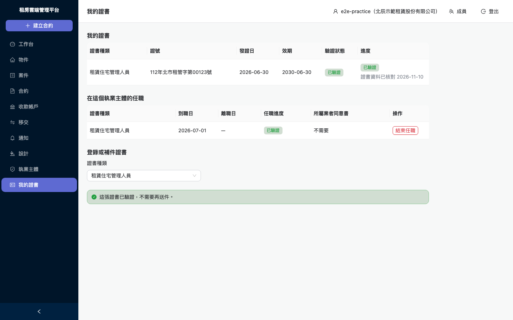

| 項目 | 分數 | 理由 |
| -- | -- | -- |
| 速度 | 3 | 沒有骨架畫面也沒有轉圈，約 1.4 秒才出現內容 |
| 一致 | 1 | 縱向堆疊的資料區塊，與執業主體頁相同做法，與列表、詳情版型都不同 |
| 狀態 | 3 | 證書與任職顯示已驗證、待驗證、需要補件，並寫出「證書資料已核對」與核對日 |
| 導覽 | 4 | 選單標出目前位置（我的證書） |
| 視覺 | 1 | 後台殼層側欄是深色，inline style 21 處 |
| 回饋 | 3 | 個資告知、登錄、結束任職有訊息；阻擋時顯示固定訊息 |

載入量測（第二次載入，dev server）：穩定 1433 ms；轉圈取樣 0/4；骨架畫面 無；整頁轉圈 無。

靜態統計：3 個檔案、652 行；inline style 21；寫死色碼 0；寫死 px 6；antd 已棄用 0。

audit：P0 0、P1 0；其他（slop 與 advisory）1；已排除（無障礙與響應式）4。

- 其他：bounce-easing×1
  - `body`：cubic-bezier(0.12, 0.4, 0.29, 1.46)

### 28-desk-queue

審核台佇列。角色：operator。路由：`/desk`。版型分類：列表。

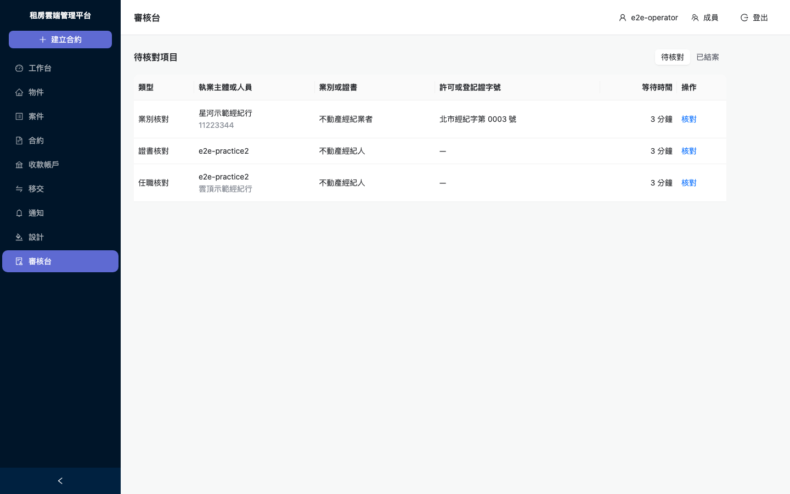

| 項目 | 分數 | 理由 |
| -- | -- | -- |
| 速度 | 2 | 沒有骨架畫面也沒有轉圈，約 3.3 秒才出現內容 |
| 一致 | 2 | 標題加切換加表格，與其他列表近似 |
| 狀態 | 2 | 類型以文字顯示，沒有狀態標籤，等待時間以文字顯示 |
| 導覽 | 4 | 選單標出目前位置（審核台） |
| 視覺 | 2 | 後台殼層側欄是深色，inline style 2 處 |
| 回饋 | 1 | 唯讀佇列，沒有載入失敗的畫面 |

載入量測（第二次載入，dev server）：穩定 3307 ms；轉圈取樣 0/3；骨架畫面 無；整頁轉圈 無。

靜態統計：2 個檔案、133 行；inline style 2；寫死色碼 0；寫死 px 0；antd 已棄用 0。

audit：P0 0、P1 1；其他（slop 與 advisory）0；已排除（無障礙與響應式）2。

- P1（人工）：平台營運者的側欄出現「建立合約」「物件」「案件」「合約」「收款帳戶」「移交」，營運者沒有這些頁面的用途，會誤點

### 29-desk-item-license

審核台項目（業別核對）。角色：operator。路由：`/desk/items/{deskLicense}`。版型分類：詳情。

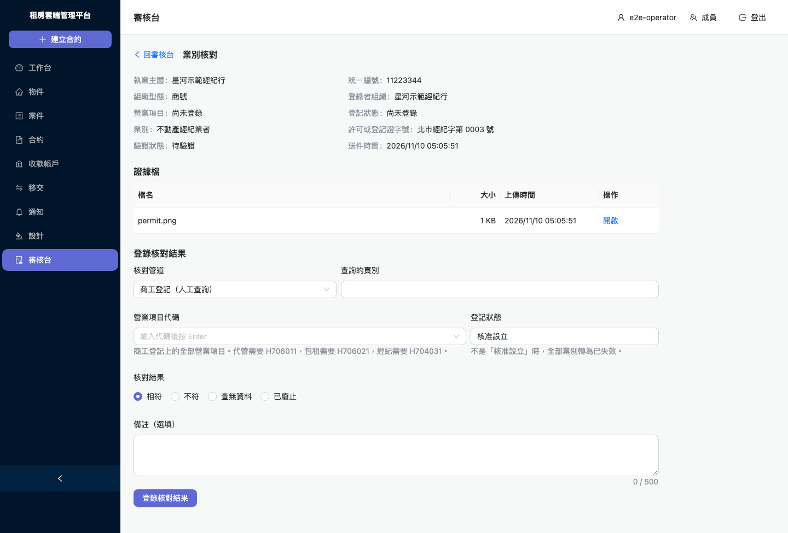

| 項目 | 分數 | 理由 |
| -- | -- | -- |
| 速度 | 3 | 沒有骨架畫面也沒有轉圈，約 1.6 秒才出現內容 |
| 一致 | 2 | 返回連結加標題加描述加表單，結構與其他詳情不同 |
| 狀態 | 2 | 驗證狀態顯示「待驗證」文字，沒有標籤 |
| 導覽 | 4 | 選單標出目前位置（審核台），有返回列表的連結 |
| 視覺 | 1 | 後台殼層側欄是深色，inline style 20 處 |
| 回饋 | 3 | 登錄核對結果有成功與錯誤訊息，422 會列出缺少的營業項目 |

載入量測（第二次載入，dev server）：穩定 1557 ms；轉圈取樣 0/3；骨架畫面 無；整頁轉圈 無。

靜態統計：3 個檔案、761 行；inline style 20；寫死色碼 0；寫死 px 6；antd 已棄用 0。

audit：P0 0、P1 0；其他（slop 與 advisory）1；已排除（無障礙與響應式）7。

- 其他：bounce-easing×1
  - `body`：cubic-bezier(0.12, 0.4, 0.29, 1.46)

### 30-desk-item-credential

審核台項目（證書或任職核對）。角色：operator。路由：`/desk/items/{deskCredential}`。版型分類：詳情。

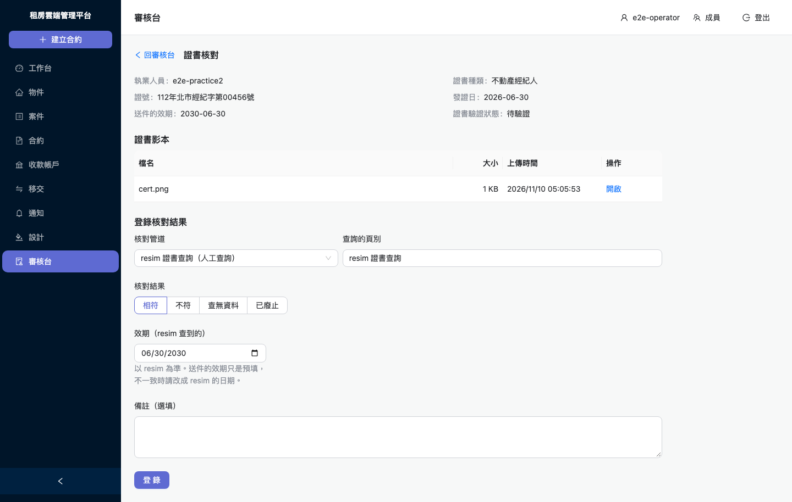

| 項目 | 分數 | 理由 |
| -- | -- | -- |
| 速度 | 3 | 沒有骨架畫面也沒有轉圈，約 1.4 秒才出現內容 |
| 一致 | 2 | 與業別核對同一版型 |
| 狀態 | 2 | 驗證狀態顯示文字，沒有標籤 |
| 導覽 | 4 | 選單標出目前位置（審核台），有返回列表的連結 |
| 視覺 | 1 | 後台殼層側欄是深色，inline style 20 處 |
| 回饋 | 3 | 登錄核對結果有成功與錯誤訊息 |

載入量測（第二次載入，dev server）：穩定 1426 ms；轉圈取樣 0/3；骨架畫面 無；整頁轉圈 無。

靜態統計：3 個檔案、761 行；inline style 20；寫死色碼 0；寫死 px 6；antd 已棄用 0。

audit：P0 0、P1 0；其他（slop 與 advisory）1；已排除（無障礙與響應式）4。

- 其他：bounce-easing×1
  - `body`：cubic-bezier(0.12, 0.4, 0.29, 1.46)

### 31-login

登入頁。角色：anonymous。路由：`/login`。版型分類：登入。


| 項目 | 分數 | 理由 |
| -- | -- | -- |
| 速度 | 2 | 沒有骨架畫面也沒有轉圈，約 5.3 秒才出現內容 |
| 一致 | 2 | 置中卡片，與後台殼層完全不同的外觀（沒有殼層） |
| 狀態 | 2 | 沒有狀態概念，錯誤以提示框顯示 |
| 導覽 | 3 | 單頁流程，沒有導覽需求，給 3 分 |
| 視覺 | 3 | 殼層是亮色，inline style 2 處 |
| 回饋 | 3 | 驗證碼寄出、錯誤、重寄倒數都有提示，錯誤訊息一律相同以避免洩漏 |

載入量測（第二次載入，dev server）：穩定 5307 ms；轉圈取樣 0/3；骨架畫面 無；整頁轉圈 無。

靜態統計：2 個檔案、204 行；inline style 2；寫死色碼 0；寫死 px 0；antd 已棄用 0。

audit：P0 0、P1 0；其他（slop 與 advisory）1；已排除（無障礙與響應式）2。

- 其他：bounce-easing×1
  - `body`：cubic-bezier(0.12, 0.4, 0.29, 1.46)

### 32-onboarding

登入後選身分（第一次登入）。角色：anonymous。路由：`/login?notice=no-identity`。版型分類：登入。


| 項目 | 分數 | 理由 |
| -- | -- | -- |
| 速度 | 3 | 沒有骨架畫面也沒有轉圈，約 1.8 秒才出現內容 |
| 一致 | 2 | 同登入頁的置中卡片 |
| 狀態 | 2 | 沒有狀態概念，兩個身分選項以卡片按鈕呈現 |
| 導覽 | 3 | 單頁流程，有「登出並改用其他 email」，沒有導覽需求，給 3 分 |
| 視覺 | 3 | 殼層是亮色，inline style 7 處 |
| 回饋 | 3 | 送出結果一律顯示已送出，錯誤顯示在欄位旁 |

載入量測（第二次載入，dev server）：穩定 1772 ms；轉圈取樣 0/3；骨架畫面 無；整頁轉圈 無。

靜態統計：1 個檔案、213 行；inline style 7；寫死色碼 0；寫死 px 0；antd 已棄用 0。

audit：P0 0、P1 0；其他（slop 與 advisory）0；已排除（無障礙與響應式）1。


### 33-master-lease-detail

合約詳情（包租，執業人員兼甲方）。角色：practice。路由：`/contracts/{masterLease}`。版型分類：詳情。

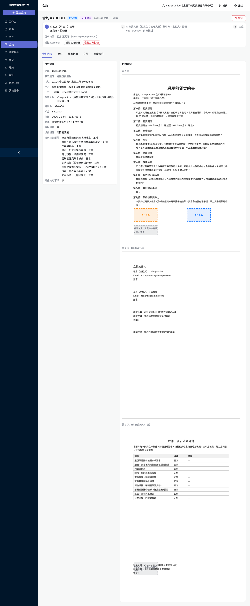

| 項目 | 分數 | 理由 |
| -- | -- | -- |
| 速度 | 1 | 局部轉圈很久（92/96 次取樣），約 16.4 秒 |
| 一致 | 2 | 與兩方合約的詳情同一版型 |
| 狀態 | 3 | 三步進度加「目前待簽」寫出當前簽署人 |
| 導覽 | 2 | 選單標出目前位置（合約），沒有返回列表的連結 |
| 視覺 | 1 | 後台殼層側欄是深色，inline style 27 處，寫死色碼 1 處 |
| 回饋 | 3 | 撤回與模擬事件有訊息與確認 |

載入量測（第二次載入，dev server）：穩定 16382 ms；轉圈取樣 92/96；骨架畫面 無；整頁轉圈 無。

靜態統計：2 個檔案、951 行；inline style 27；寫死色碼 1；寫死 px 0；antd 已棄用 4。

audit：P0 0、P1 2；其他（slop 與 advisory）0；已排除（無障礙與響應式）9。

- P1（detect）：first-viewport-column-overflow×1
  - `div.ant-row`：div.ant-row.css-dev-only-do-not-override-ry7cab.css-var-_R_lb_ opens the page with one column running 346% of the viewport tall while a sibl
- P1（人工）：詳情頁沒有返回合約列表的連結

### 34-master-lease-wizard-fields

建約精靈 包租 步驟四（附件與簽署序列）。角色：practice。路由：`/contracts/{masterLeaseDraft}/edit`。版型分類：精靈。

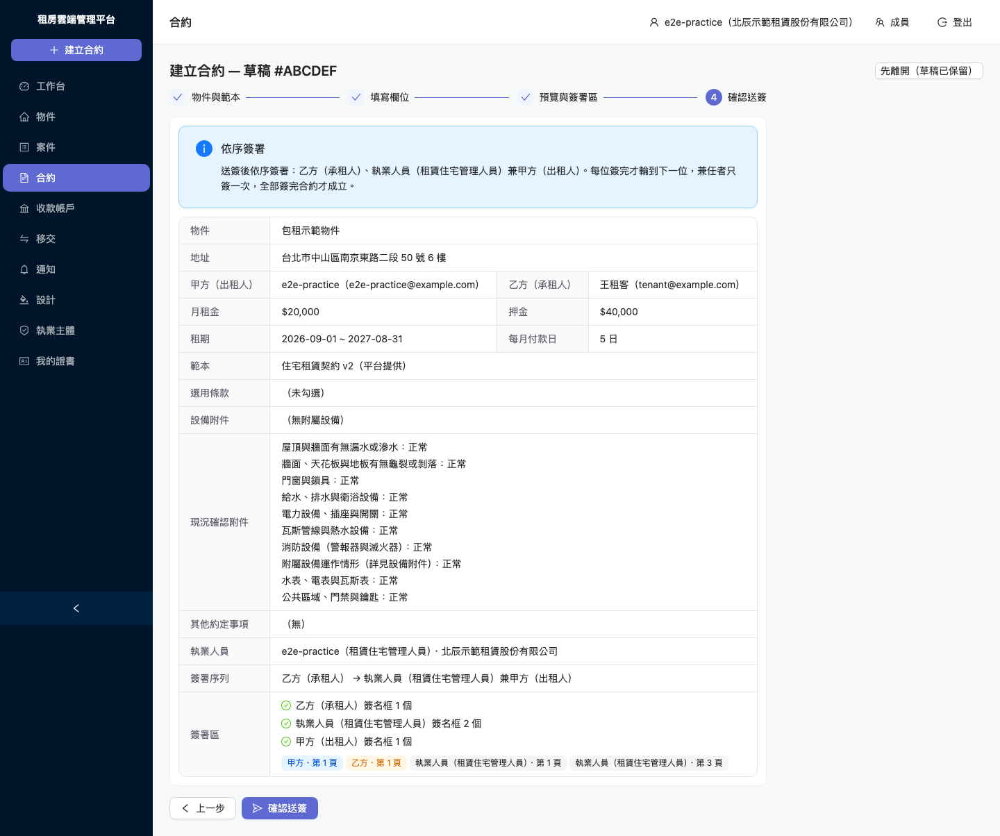

| 項目 | 分數 | 理由 |
| -- | -- | -- |
| 速度 | 2 | 載入中是局部轉圈（1/4 次取樣），約 1.3 秒 |
| 一致 | 2 | 與其他精靈步驟同一結構，附件表格加指派面板，欄位多，頁面很長 |
| 狀態 | 2 | 附件每列有狀態下拉，未填顯示「未填」，沒有彙總 |
| 導覽 | 4 | 選單標出目前位置（合約） |
| 視覺 | 0 | 後台殼層側欄是深色，inline style 57 處，寫死色碼 2 處 |
| 回饋 | 3 | 送簽前檢查列出全部缺少的項目，欄位錯誤顯示在欄位旁 |

載入量測（第二次載入，dev server）：穩定 1274 ms；轉圈取樣 1/4；骨架畫面 無；整頁轉圈 無。

靜態統計：10 個檔案、2125 行；inline style 57；寫死色碼 2；寫死 px 3；antd 已棄用 7。

audit：P0 0、P1 0；其他（slop 與 advisory）2；已排除（無障礙與響應式）1。

- 其他：nested-cards×2
  - `div.ant-alert.ant-alert-info`：Card inside card
  - `div.ant-descriptions-view`：Card inside card

### 35-design

設計樣式頁（內部工具）。角色：owner。路由：`/design`。版型分類：總覽。

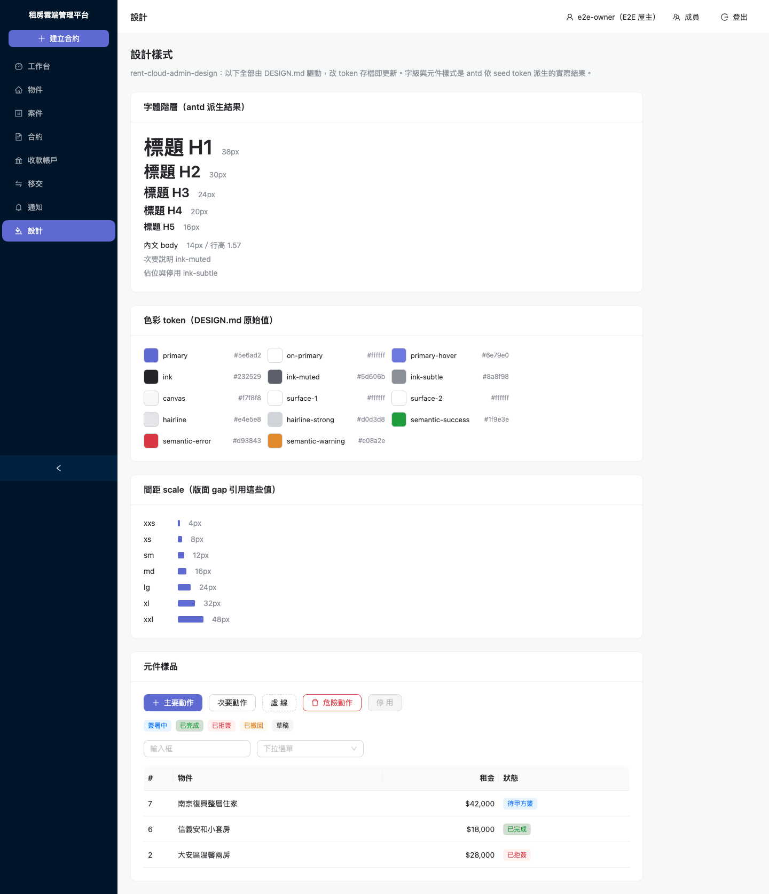

| 項目 | 分數 | 理由 |
| -- | -- | -- |
| 速度 | 3 | 沒有骨架畫面也沒有轉圈，約 1.5 秒才出現內容 |
| 一致 | 1 | 內部工具頁，用卡片堆疊展示 token，與其他頁無關 |
| 狀態 | 2 | 展示了 5 種狀態標籤，但顏色寫在展示頁自己的程式碼 |
| 導覽 | 4 | 選單標出目前位置（設計） |
| 視覺 | 1 | 後台殼層側欄是深色，inline style 14 處 |
| 回饋 | 1 | 唯讀展示頁，沒有操作 |

載入量測（第二次載入，dev server）：穩定 1549 ms；轉圈取樣 0/3；骨架畫面 無；整頁轉圈 無。

靜態統計：2 個檔案、195 行；inline style 14；寫死色碼 0；寫死 px 1；antd 已棄用 0。

audit：P0 0、P1 0；其他（slop 與 advisory）0；已排除（無障礙與響應式）11。


## 積欠的畫面驗收

每張票的驗收留言在 Linear，截圖在本目錄（`acc-*.png`）。結果分三種：通過、不通過、畫面看不到。「畫面看不到」指驗收條件不經過畫面（稽核事件、資料刪除、權限、純函式），這張票沒有驗收，靠單元測試與資料庫測試涵蓋。

### MIL-123

| 驗收項目 | 結果 | 說明 |
| -- | -- | -- |
| 案件頁有「帳務設定」分頁，內容分五區 | 通過 | 五區標題都在畫面上（[截圖](acc-mil123-ledger.png)） |
| 合約全員完成後，押金台帳顯示約定金額與餘額 | 通過 | 約定金額 $40,000 等於合約押金（[截圖](acc-mil123-ledger.png)） |
| 應收期別一個月一期，租期 12 個月有 12 列 | 通過 | 表格資料列共 12 列（2 張表）（[截圖](acc-mil123-ledger.png)） |
| 案件得登錄匯款識別，登錄後有成功回饋 | 通過 | 填付款人戶名「王大明」按新增，畫面顯示「已登錄匯款識別」 |
| 案件得設租金與押金的預設收款帳戶，儲存後有成功回饋 | 通過 | 選租金的預設帳戶按儲存，畫面顯示「已儲存預設收款帳戶」 |
| 登錄匯款識別與預設帳戶之後的畫面 | 通過 | 截圖（[截圖](acc-mil123-after-edit.png)） |
| 社宅旗標的修改、原因欄與持有人衝突提示 | 畫面看不到 | 自管案件的畫面沒有「改為社宅代管案件」按鈕。旗標編輯與衝突提示只在代管案件出現，這個環境沒有代管案件，沒有驗收 |
| migration 外鍵 | 畫面看不到 | 不經過畫面，由單元測試與真實 PostgreSQL 測試涵蓋，這張票沒有驗收 |
| 期別切分純函式與首末期比例 | 畫面看不到 | 不經過畫面，由單元測試與真實 PostgreSQL 測試涵蓋，這張票沒有驗收 |
| 提前終止改 cancelled | 畫面看不到 | 不經過畫面，由單元測試與真實 PostgreSQL 測試涵蓋，這張票沒有驗收 |
| 旗標修改寫稽核並通知委託人 | 畫面看不到 | 不經過畫面，由單元測試與真實 PostgreSQL 測試涵蓋，這張票沒有驗收 |
| 押金台帳表的 RLS 與滲透測試 | 畫面看不到 | 不經過畫面，由單元測試與真實 PostgreSQL 測試涵蓋，這張票沒有驗收 |

### MIL-121

| 驗收項目 | 結果 | 說明 |
| -- | -- | -- |
| 兩個組織的案件都列出 | 通過 | 列表有 4 個案件連結（屋主一的簽署中、已完成、已拒簽案件，加屋主二的簽署中案件）（[截圖](acc-mil121-list.png)） |
| 案件詳情顯示合約狀態，已完成的合約能下載已簽 PDF | 通過 | 有「下載已簽合約」連結（[截圖](acc-mil121-detail.png)） |
| 375px 寬沒有水平捲動 | 通過 | 列表與詳情在 375px 寬都沒有水平捲動（[截圖](t1-tenant-list-375.png)） |
| email 不屬於任何案件時只顯示「沒有案件」 | 畫面看不到 | 承租人身分要有案件成員關係才成立，E2E 沒有辦法登入成沒有案件的承租人。空狀態文字在 TenantCaseList.tsx，沒有驗收 |
| 結案後唯讀、仍能下載 | 畫面看不到 | 案件結案要走退租與結算流程（E 線），這個環境沒有可結案的案件，沒有驗收 |
| 更新成員 email 後舊 email 失效，並寫稽核事件 | 畫面看不到 | 操作在出租人端，結果是 session 與稽核，這張票沒有驗收 |
| 承租人讀不到別的案件 | 畫面看不到 | 權限與 RLS，由 PostgreSQL 測試涵蓋，這張票沒有驗收 |

### MIL-72

| 驗收項目 | 結果 | 說明 |
| -- | -- | -- |
| 詳情頁列出每位簽署人的角色、姓名與狀態 | 通過 | 甲方、乙方、執業人員三個角色都出現在詳情頁（[截圖](acc-mil72-master-detail.png)） |
| 清單的簽署進度依序列顯示 | 通過 | 包租合約那一列顯示「待乙方簽」與三個進度點（乙方、執業人員兼甲方、完成），停在第一點。進度點數量以截圖為準（[截圖](acc-mil72-contracts-list.png)） |
| 工作台的待辦（乙方還沒簽時） | 通過 | 乙方輪次時，待辦只列草稿，簽署中的包租合約不在待辦裡，球不在執業主體手上（[截圖](acc-mil72-workbench.png)） |
| 乙方簽署後，進度移到第二位簽署人（執業人員兼甲方） | 通過 | 詳情頁的目前待簽變成「執業人員」，進度停在第二位 |
| 輪到執業人員兼甲方時，工作台的待辦出現這份合約 | 通過 | 待辦區出現包租示範物件（執業人員與甲方是同一人，輪到時待辦出現）（[截圖](acc-mil72-workbench-practitioner-turn.png)） |
| 三位不同的簽署人（甲方、乙方、執業人員各一人） | 畫面看不到 | 這個環境的執業人員與甲方是同一人，合併成兩位簽署人，沒有驗收三位不同簽署人的情境。需要有一位不是當事人的執業人員才能驗收 |
| 確認頁的順序說明由簽署序列產生 | 通過 | 確認頁顯示「依序簽署：乙方、執業人員兼甲方」，由簽署序列產生，沒有固定的「乙方先簽」文字（[截圖](acc-mil71-master-wizard.png)） |
| 進度步驟與位置是純函式（2、3、4 位測試） | 畫面看不到 | 純函式與查詢方式，由 vitest 涵蓋，這張票沒有驗收 |
| 清單批次查簽署進度，不逐列查詢 | 畫面看不到 | 純函式與查詢方式，由 vitest 涵蓋，這張票沒有驗收 |
| 既有合約沒有簽署任務時畫面不報錯 | 畫面看不到 | 純函式與查詢方式，由 vitest 涵蓋，這張票沒有驗收 |

### MIL-71

| 驗收項目 | 結果 | 說明 |
| -- | -- | -- |
| 詳情頁的合約內容含現況確認附件頁 | 通過 | 合約內容預覽有「現況確認附件」（[截圖](acc-mil72-master-detail.png)） |
| 缺少執業人員在附件頁的簽署區域時，送簽被擋下並列出原因 | 通過 | 送簽回 400，原因含「請在現況確認附件頁為執業人員放置簽名框」（以 API 回應驗收，確認頁列出同一組原因） |
| 包租租賃合約的精靈出現現況確認附件 | 通過 | 精靈確認頁有「現況確認附件」摘要（[截圖](acc-mil71-master-wizard.png)） |
| 附件在填寫欄位步驟有狀態與備註可填 | 通過 | 回到步驟二，附件區每列有狀態與備註（截圖）（[截圖](acc-mil71-annex-editor.png)） |
| 屋主的租賃合約不顯示現況確認附件 | 通過 | 屋主的草稿精靈沒有現況確認附件 |
| 附件內容隨草稿保存，送簽後凍結為快照 | 畫面看不到 | 資料與 PDF 層的規則，由 vitest 涵蓋，這張票沒有驗收 |
| 附件頁排在簽署欄之後、不影響簽署欄落點 | 畫面看不到 | 資料與 PDF 層的規則，由 vitest 涵蓋，這張票沒有驗收 |
| 既有合約的 PDF 不變 | 畫面看不到 | 資料與 PDF 層的規則，由 vitest 涵蓋，這張票沒有驗收 |
| PDF 測試驗證附件頁的文字 | 畫面看不到 | 資料與 PDF 層的規則，由 vitest 涵蓋，這張票沒有驗收 |

### MIL-111

| 驗收項目 | 結果 | 說明 |
| -- | -- | -- |
| 開啟證書登錄頁先顯示個資告知，同意才顯示表單 | 通過 | 沒有同意前只有告知與同意、不同意按鈕（[截圖](acc-mil111-consent-gate.png)） |
| 證號三段、證書種類、發證日、效期必填，效期預填發證日加 4 年 | 通過 | 發證日填 2026-01-15，效期預填 2030-01-15（[截圖](acc-mil111-b-panel.png)） |
| 效期與發證日加 4 年不一致時提示 | 通過 | 效期改成 2030-06-30，畫面顯示不一致的提示 |
| 管理人員在別家已有已驗證在職時阻擋，訊息為「此證號已有在職紀錄」 | 通過 | 乙用甲的證號登錄，被擋下，訊息為「此證號已有在職紀錄」，沒有顯示別家（表單送出）（[截圖](acc-mil111-blocked.png)） |
| 核對相符後，證書與任職顯示已驗證 | 通過 | 執業人員甲的頁面顯示「已驗證」（[截圖](acc-mil111-a-panel.png)） |
| 標章文字固定為「證書資料已核對」加核對日，不含禁用詞 | 通過 | 「我的證書」頁顯示「證書資料已核對 2026-11-10」，沒有「保證合法」「認證」「擔保」（[截圖](acc-mil111-a-panel.png)） |
| 屋主端看到標章 | 畫面看不到 | 標章資料已提供（getCertificateBadges），屋主端總覽與案件頁要等 MIL-102 接線才會顯示。合約詳情的執業人員列目前沒有標章，這張票沒有驗收 |
| 成員只能登錄自己的證書 | 畫面看不到 | 權限、資料庫約束、稽核或需要兩家以上已驗證執業主體的情境，這張票沒有驗收。由 vitest 與真實 PostgreSQL 測試涵蓋 |
| 別家只有待驗證時允許並存 | 畫面看不到 | 權限、資料庫約束、稽核或需要兩家以上已驗證執業主體的情境，這張票沒有驗收。由 vitest 與真實 PostgreSQL 測試涵蓋 |
| 舊任職離職後新任職為待驗證 | 畫面看不到 | 權限、資料庫約束、稽核或需要兩家以上已驗證執業主體的情境，這張票沒有驗收。由 vitest 與真實 PostgreSQL 測試涵蓋 |
| 經紀人員掛第二家時要求所屬業者同意書 | 畫面看不到 | 權限、資料庫約束、稽核或需要兩家以上已驗證執業主體的情境，這張票沒有驗收。由 vitest 與真實 PostgreSQL 測試涵蓋 |
| 同意書核對後標示「經所屬業者同意」 | 畫面看不到 | 權限、資料庫約束、稽核或需要兩家以上已驗證執業主體的情境，這張票沒有驗收。由 vitest 與真實 PostgreSQL 測試涵蓋 |
| 排除約束只涵蓋已驗證的管理人員專任任職 | 畫面看不到 | 權限、資料庫約束、稽核或需要兩家以上已驗證執業主體的情境，這張票沒有驗收。由 vitest 與真實 PostgreSQL 測試涵蓋 |
| 核對不符時維持待驗證並通知補件 | 畫面看不到 | 權限、資料庫約束、稽核或需要兩家以上已驗證執業主體的情境，這張票沒有驗收。由 vitest 與真實 PostgreSQL 測試涵蓋 |
| 證書層核對跨組織沿用 | 畫面看不到 | 權限、資料庫約束、稽核或需要兩家以上已驗證執業主體的情境，這張票沒有驗收。由 vitest 與真實 PostgreSQL 測試涵蓋 |
| 每次阻擋與提示寫稽核事件 | 畫面看不到 | 權限、資料庫約束、稽核或需要兩家以上已驗證執業主體的情境，這張票沒有驗收。由 vitest 與真實 PostgreSQL 測試涵蓋 |
| 證書影本相符後刪除、同意書在任職有效期間保留 | 畫面看不到 | 權限、資料庫約束、稽核或需要兩家以上已驗證執業主體的情境，這張票沒有驗收。由 vitest 與真實 PostgreSQL 測試涵蓋 |

## 驗收發現的問題

- [MIL-189](https://linear.app/miles-rent-poc/issue/MIL-189)：合約詳情的執業人員沒有「證書資料已核對」標章（MIL-111 驗收）
- [MIL-190](https://linear.app/miles-rent-poc/issue/MIL-190)：物件列表開啟時出現 hydration 不一致錯誤（impeccable P0）
- [MIL-191](https://linear.app/miles-rent-poc/issue/MIL-191)：平台營運者的側欄顯示屋主功能的選單項目（基準 P1）

## 資料準備與限制

資料準備的每一步獨立記錄。失敗的步驟：

- 無

- 屋主資產總覽、屋主端移交清單與發起移交（19、20、21）接假資料 adapter，資料綁在虛構屋主的 ID。真實登入的帳號只看得到空狀態，有資料時的版面要等接線票（MIL-99、MIL-101、MIL-102、MIL-105 等）完成才能量測。
- 屋主端移交詳情（22）沒有任何入口能進入，沒有截圖與評分。
- 後台移交清單與詳情（24、25）顯示的是假資料 adapter 的預設執業主體資料（北辰），與登入的執業主體組織無關。第 25 頁的畫面與量測沿用第三輪（後續輪次的資料準備沒有取到移交 ID）。
- 包租合約的執業人員與甲方是同一人，合併成兩位簽署人。三位不同簽署人的情境沒有驗收。
- 代管案件（委託管理）沒有建立，社宅旗標編輯與衝突提示沒有驗收。
- 速度量測在 dev server（webpack）上做，編譯與記憶體 PGlite 讓絕對數字偏高。比較前後時，以同樣的環境重跑，看有沒有骨架畫面與整頁轉圈。
- 「回饋」的分數依原始碼的回饋呼叫（message、Modal.confirm、Alert）與驗收時實際看到的訊息判斷。沒有逐一操作每個按鈕。
- detect 的 P0 與 P1 對應規則是這份報告自己定的（見「怎麼量的」），impeccable 本身沒有 P0 到 P3 分級。

## 重跑

```bash
HEAVY_COST=6 scripts/heavy.sh e2e-baseline scripts/e2e/run-e2e.sh baseline
node e2e/baseline/static-stats.mjs
node e2e/baseline/build-report.mjs
git checkout tsconfig.json
```

第一行約 8 分鐘，成本 6 GB。結束時最後一行是 `LISTEN 3410: 0`。評分與人工複查寫在 `data/scores.json`，重跑後要對照新截圖更新。
